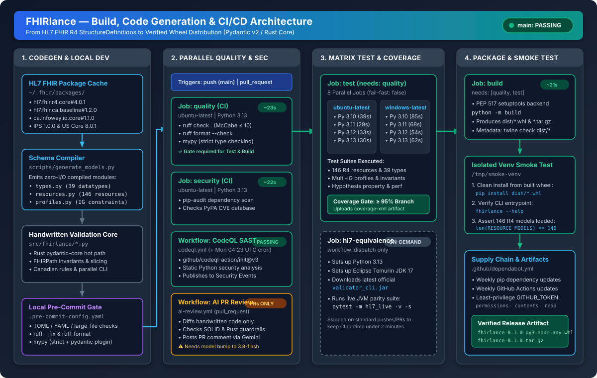

# FHIRlance

[](https://github.com/damsonaldson/FHIRlance/actions/workflows/ci.yml)
[](https://github.com/damsonaldson/FHIRlance/actions/workflows/codeql.yml)

High-performance **FHIR R4 structural & Implementation Guide profile validator** backed by Pydantic v2 (`pydantic-core` in Rust).

## Coverage
- **Full FHIR R4 Base Spec**: All **146 base resources** and **39 complex datatypes** (**659 generated Pydantic v2 model classes** covering **8,350 typed element fields**, `extra="forbid"`, strict primitive patterns/types, non-empty arrays, **186 `[x]` choice exclusivity groups**, `_primitive` JSON extensions, `Extension` `ext-1`, recursive `Bundle.entry[].resource` and `contained[]` validation, and core FHIRPath invariants).
- **Multi-IG Profile Engine**: **183 pre-compiled StructureDefinition profiles** (**2,009 individual constraints**) with `baseDefinition` inheritance across **HL7 R4 Core 4.0.1 (44 profiles), CA-Baseline 1.2.0 (27 profiles), Infoway CA Core 1.1.0 (31 profiles), HL7 IPS 1.0.0 (27 profiles), and HL7 US Core 8.0.1 (54 profiles)** — plus dynamic runtime IG loading (`-ig` / `ig_sources`) from `.tgz` packages, directories, Bundles, or StructureDefinitions (cardinality, `max=0` forbidden elements, `fixed[x]`, `pattern[x]`, `[x]` type narrowing, `Reference.targetProfile`, `required` bindings, and slicing).
- **Canadian Profile Rules**: Optional CA-Baseline / PS-CA `meta.profile`, all **13 provincial/territorial JHN NamingSystems**, `A1A 1A1` postal code FSA validation, and US-extension checks (`require_canadian_profile=True/False`).
- **Standard Output Formats**: Text, JSON, self-validating FHIR R4 `OperationOutcome`, **SARIF v2.1.0**, and **JUnit XML**.

## Proof of Functional Equivalence & Test Suite Breadth

See **[Proof of Functional Equivalence & Test Suite Architecture](docs/equivalence-and-testing.md)** for the full methodology, side-by-side equivalence matrix, and module-by-module test catalog.

FHIRlance is continuously verified for functional equivalence against HL7's official Java Reference Implementation (**`validator_cli.jar`** from `hapifhir/org.hl7.fhir.core`, `-version 4.0.1 -tx n/a`) and backed by an exhaustive **2,697-item pytest suite** evaluating **8,300+ distinct validation scenarios** at **99.6% statement and branch coverage**:

| Test Suite Tier | Module(s) | Pytest Items | Scenarios Evaluated | What Is Verified |
| :--- | :--- | ---: | ---: | :--- |
| **Live HL7 `validator_cli.jar` Equivalence** | [`test_all_146_live_hl7_equivalence.py`](tests/test_all_146_live_hl7_equivalence.py)<br/>[`test_validator_equivalence.py`](tests/test_validator_equivalence.py) | **12** (`11` `hl7_live` + `1` offline) | **378** (`335` live JVM + `43` offline) | Direct differential comparison against `validator_cli.jar` across all **146 R4 resource types** (146 valid official examples + 146 mutated invalid cases), **10 FHIRPath invariants**, **11 strict primitives**, `[x]` choice exclusivity, `_primitive` extensions, recursive `Bundle`/`contained[]` resources, and **R4 Vital Signs, US Core 8.0.1, IPS 1.0.0, and CA-Baseline** profiles. |
| **Multi-IG Profile Constraint Matrix** | [`test_all_183_ig_profiles.py`](tests/test_all_183_ig_profiles.py) | **1,268** | **4,190+** | Every one of the **183 compiled IG profiles** across all 5 IGs and all **2,009 individual profile rules**: positive & negative verification of `537` required (`min>=1`), `501` `max="1"`, `424` `Reference.targetProfile`, `268` `[x]` type narrowing, `78` required ValueSet bindings, `69` discriminator slices, `56` forbidden (`max="0"`), `49` `fixed[x]`, and `27` `pattern[x]` constraints. |
| **Full FHIR R4 Resource & Choice Matrix** | [`test_full_r4_coverage.py`](tests/test_full_r4_coverage.py) | **917** | **2,400+** | All **146 R4 resource models** (valid minimal synthesis, `extra="forbid"`, `min_length=1` empty arrays, `FHIRId`/`FHIRCode` primitives, `txt-1`/`ext-1`/`_primitive` extensions, mandatory field omission) + all **186 `[x]` choice groups** across all **659 generated model classes**. |
| **Complex Datatypes, Primitives & Bindings** | [`test_complex_types_and_primitives.py`](tests/test_complex_types_and_primitives.py) | **342** | **620+** | All **54 complex datatype & BackboneElement classes** in `types.py`, **112 strict primitive boundary cases** (leap years `2024-02-29` vs `2023-02-29`, leap seconds `:60`, timezone bounds `+14:00`, boolean-as-integer rejection), and all **176 root resource `Literal` ValueSet bindings**. |
| **Invariants, Canadian Rules & Unit Matrix** | [`test_invariants_and_profiles_unit.py`](tests/test_invariants_and_profiles_unit.py)<br/>[`test_comprehensive_profiles_and_resilience.py`](tests/test_comprehensive_profiles_and_resilience.py)<br/>[`test_codegen_unit.py`](tests/test_codegen_unit.py) | **111** | **240+** | All **10 FHIRPath invariants** across 11 `Observation.value[x]` fields, 5 `Condition.abatement[x]` fields, 4 `Patient.contact` fields, and 9 `Bundle.type` codes; all **13 Canadian provincial JHN systems**, **29 postal code FSA cases**, **15 CA profiles**, recursion depth guard (`>16`), and schema compiler unit tests. |
| **Formatters, Dynamic IG Loader & Parallelism** | [`test_output_ig_and_parallel.py`](tests/test_output_ig_and_parallel.py) | **41** | **150+** | Self-validating FHIR R4 `OperationOutcome`, SARIF v2.1.0, JUnit XML; runtime IG loading from `.tgz`/directory/Bundle/SD with ZipSlip & member limits; sequential vs multi-process intra-file/inter-file exact equality. |
| **Property-Based Fuzzing & Hot-Path Guard** | [`test_property_and_perf.py`](tests/test_property_and_perf.py) | **6** | **405+** | Hypothesis property-based fuzzing (200 arbitrary JSON & mutated resource structures), strict JSON `NaN`/`Infinity` rejection, zero Python `model_validators` on `FHIRBaseModel`, and `<0.5s` throughput guard for 200 validations. |

## Performance & Benchmarks

Updated automatically on every build via [`scripts/benchmark_performance.py`](scripts/benchmark_performance.py) (`python scripts/benchmark_performance.py --update-docs`; raw metrics persisted to [`docs/benchmark-results.json`](docs/benchmark-results.json)).

<!-- PERFORMANCE_BENCHMARK_START -->
**Release**: `v0.1.0` | **Python**: `3.13.7` | **Pydantic**: `v2.14.3` (Rust `pydantic-core`) | **Master Suite**: `2,697` pytest items (`8,380+` scenarios, `99.62%` coverage) | **Updated**: `2026-11-14 17:45 UTC`

#### 1. Master Equivalence Dataset (`325` Resources across all `146` R4 Types, `10` Invariants & `5` IGs)

| Validator / Execution Mode | API / Command | Batch Elapsed (`325` Resources) | Latency per Resource | Throughput (`resources/s`) | Speedup vs. HL7 Baseline |
| :--- | :--- | ---: | ---: | ---: | ---: |
| **FHIRlance — Standard Mode** | `validate_resource(res)` (`list[str]`) | **`11.67 ms`** | **`35.9 µs`** | **`27,847 res/s`** | **`3,010.1x faster`** |
| **FHIRlance — FHIR Output (`OperationOutcome`) Mode** | `validate_to_operation_outcome(res)` (FHIR R4 `OperationOutcome`) | **`12.70 ms`** | **`39.1 µs`** | **`25,590 res/s`** | **`2,766.1x faster`** |
| **Official HL7 Baseline Validator** | `java -jar validator_cli.jar -version 4.0.1 -tx n/a -output` | `35.13 s` (`35,130 ms`) | `108.09 ms` (`108,092 µs`) | `9.25 res/s` | `1.0x` (baseline) |

#### 2. High-Volume NDJSON Dataset & Master Test Suite Throughput

| Benchmark Workload | Mode | Volume | Elapsed Time | Effective Throughput |
| :--- | :--- | ---: | ---: | ---: |
| **NDJSON Dataset Batch (`validate_dataset`)** | Standard Report Mode (`dict` / JSON) | `1,000` resources | **`60.35 ms`** | **`16,570 resources/s`** |
| **NDJSON Dataset Batch (`--format operation-outcome`)** | FHIR R4 `OperationOutcome` Mode | `1,000` resources | **`73.05 ms`** | **`13,689 resources/s`** |
| **Master Offline Pytest Suite (`pytest -m "not hl7_live"`)** | Full R4 (`146` types) + `183` IG Profiles (`2,009` rules) + Fuzzing | `2,686` test items (`8,380+` scenarios) | `~12.5 s` (no-cov) / `~32.9 s` (branch-cov) | **`~670 scenarios/s`** |
<!-- PERFORMANCE_BENCHMARK_END -->

## Architecture
- `base.py`: `FHIRBaseModel` (pure Rust `pydantic-core` hot path), `ExtensionBase` (`ext-1`), `DomainResourceBase`, strict R4 primitives.
- `types.py` & `resources.py`: Auto-generated Pydantic v2 models (never edit by hand).
- `profiles.py`: Auto-generated IG profile constraint definitions (never edit by hand).
- `profile_engine.py`: Typed, pre-compiled StructureDefinition constraint evaluator.
- `ig_loader.py`: Runtime Implementation Guide loader (`.tgz`, directory, Bundle, StructureDefinition, and `~/.fhir/packages` cache).
- `invariants.py`: Core FHIRPath invariant dispatchers (`txt-1`, `pat-1`, `obs-6`, `obs-7`, `con-4`, `bdl-1`, `bdl-3`, `bdl-4`, `bdl-7`).
- `primitive_extensions.py`: Lazy `_primitive` JSON extension fallback invoked only when needed.
- `canadian.py`: Pan-Canadian profile and patient localization rules.
- `formatters.py`: `OperationOutcome`, SARIF v2.1.0, JUnit XML, JSON, and text report formatters.
- `resource_validator.py`: Single-resource validation orchestrator and depth-guarded recursion.
- `dataset.py`: Strict JSON (`NaN`/`Infinity`-rejecting) and sequential/parallel dataset runner.
- `validator.py`: Backward-compatible public validation facade.
- `cli.py`: `fhirlance` CLI entrypoint.

## Usage

### CLI Reference (`fhirlance`)

```text
usage: fhirlance [-h] [--no-canadian] [--profile PROFILE] [-ig IG_SOURCES]
                 [--parallel]
                 [--format {text,json,operation-outcome,sarif,junit}]
                 [--operation-outcome] [--json] [-o OUTPUT_PATH]
                 target
```

#### Positional Arguments & Flags

| Argument / Flag | Repeatable | Default | Description |
| :--- | :---: | :--- | :--- |
| `target` | No | *(Required)* | Path to a FHIR `.json` file (single resource or `Bundle`), `.ndjson` file, or directory containing `.json` / `.ndjson` files. |
| `-h`, `--help` | No | — | Display CLI usage help and exit. |
| `--no-canadian` | No | `False` | Disable Canadian localization checks (`meta.profile` presence, provincial/territorial JHN NamingSystem checks, `A1A 1A1` postal code FSA validation, and US-extension restrictions). |
| `--profile <URL>` | **Yes** | `None` | Additional `StructureDefinition` canonical URL to validate resources against (evaluated alongside any profiles declared in `resource.meta.profile`). |
| `-ig <SOURCE>`, `--ig <SOURCE>` | **Yes** | `None` | Load custom FHIR Implementation Guide(s) at runtime from an NPM tarball (`.tgz` / `.tar.gz`), unpacked directory, `Bundle` / `StructureDefinition` `.json` file, or `~/.fhir/packages` specifier (`<pkg>#<version>` or `<pkg>`). |
| `--parallel` | No | `False` | Validate multi-file directories, multi-entry `Bundle` JSON files (`>= 64` entries), and multi-line `.ndjson` files (`>= 64` lines) in parallel across worker processes (`ProcessPoolExecutor`). |
| `--format <FMT>` | No | `text` | Output format: `text`, `json`, `operation-outcome`, `sarif`, or `junit` (see table below). |
| `--operation-outcome` | No | `False` | Shorthand alias for `--format operation-outcome` (emits a compliant FHIR R4 `OperationOutcome` JSON resource). |
| `--json` | No | `False` | Shorthand alias for `--format json` (emits the full structured JSON dataset report). |
| `-o <PATH>`, `--output <PATH>` | No | `stdout` | Write the formatted validation report to `<PATH>` (UTF-8) instead of printing to `stdout`. |

#### Supported Output Formats (`--format`)

| Format | Flag / Shorthand | Output Structure & Use Case |
| :--- | :--- | :--- |
| **`text`** | `--format text` *(default)* | Human-readable summary line (`Validated N resource(s) in X.XXXXs \| valid=... invalid=...`) followed by up to 20 issue descriptions. |
| **`json`** | `--format json` or `--json` | Full JSON summary dictionary (`total_resources`, `valid_resources`, `invalid_resources`, `compliance_rate`, `elapsed_seconds`, and per-resource `issues`). |
| **`operation-outcome`** | `--format operation-outcome` or `--operation-outcome` | Self-validating **FHIR R4 `OperationOutcome`** JSON resource with mapped `IssueType` codes (`structure`, `invariant`, `code-invalid`, `required`, `value`, `exception`), `diagnostics`, and FHIRPath `expression` locations. |
| **`sarif`** | `--format sarif` | **OASIS SARIF v2.1.0** static analysis JSON report with categorized rules (`FHIR001-Structural` through `FHIR005-ParseError`) for GitHub Code Scanning and IDE integration. |
| **`junit`** | `--format junit` | **JUnit XML** (`<testsuites>` / `<testcase>` / `<failure>`) report for CI/CD test runners. |

#### Exit Codes

| Exit Code | Meaning |
| :---: | :--- |
| `0` | All validated resources passed with zero structural, invariant, or profile issues. |
| `1` | One or more resources failed validation or a file could not be parsed. |
| `2` | Invalid CLI arguments or `target` path does not exist (`FileNotFoundError`). |

#### CLI Examples

```bash
# 1. Validate a directory of FHIR Bundles/NDJSON with base R4 + IG profiles (disable Canadian rules) and multiprocessing
fhirlance path/to/data --no-canadian --parallel

# 2. Emit a standard FHIR R4 OperationOutcome JSON resource to a file
fhirlance path/to/patient.json --no-canadian --operation-outcome -o outcome.json

# 3. Validate against explicit StructureDefinition profile URLs (repeatable)
fhirlance path/to/observations.ndjson --no-canadian \
  --profile http://hl7.org/fhir/StructureDefinition/vitalsigns \
  --profile http://hl7.org/fhir/StructureDefinition/heartrate

# 4. Load custom runtime Implementation Guides (.tgz tarball, folder, or cached package)
fhirlance path/to/data --no-canadian \
  -ig path/to/custom-ig.tgz \
  -ig hl7.fhir.uv.ips#1.0.0 \
  --format operation-outcome -o ips-outcome.json

# 5. Generate SARIF v2.1.0 or JUnit XML reports for CI pipelines
fhirlance path/to/data --no-canadian --format sarif -o results.sarif.json
fhirlance path/to/data --no-canadian --format junit -o junit-report.xml
```

---

### Python API

```python
from fhirlance import (
    dataset_to_junit_xml,
    dataset_to_operation_outcome,
    dataset_to_sarif,
    format_dataset_report,
    register_ig,
    validate_dataset,
    validate_resource,
    validate_to_operation_outcome,
)

# 1. Validate a single resource dictionary -> list[str]
issues = validate_resource(
    resource_dict,
    require_canadian_profile=False,
    profile_urls=["http://hl7.org/fhir/StructureDefinition/vitalsigns"],
    ig_sources=["path/to/custom-ig.tgz"],
)

# 2. Validate a single resource directly into a FHIR R4 OperationOutcome dict
outcome = validate_to_operation_outcome(
    resource_dict,
    require_canadian_profile=False,
)

# 3. Validate a file (.json / .ndjson) or directory in parallel
report = validate_dataset(
    "path/to/bundles_or_ndjson",
    parallel=True,
    require_canadian_profile=False,
    profile_urls=["http://hl7.org/fhir/us/core/StructureDefinition/us-core-patient"],
    ig_sources=["path/to/custom-ig.tgz"],
)

# 4. Format a dataset report into OperationOutcome, SARIF v2.1.0, or JUnit XML
oo_dict = dataset_to_operation_outcome(report)
sarif_dict = dataset_to_sarif(report)
junit_xml_str = dataset_to_junit_xml(report)
formatted_str = format_dataset_report(report, output_format="operation-outcome")

# 5. Register a custom IG globally for the current process
register_ig("path/to/custom-ig.tgz")
```

---

### Build & Maintenance Scripts (`scripts/`)

```bash
# Regenerate types.py, resources.py, and profiles.py from ~/.fhir/packages
python scripts/generate_models.py

# Run performance benchmarks and update README.md, docs/equivalence-and-testing.md, and docs/benchmark-results.json
python scripts/benchmark_performance.py --update-docs

# Re-run live HL7 validator_cli.jar baseline benchmark and update docs
python scripts/benchmark_performance.py --run-hl7-live --update-docs
```

## Development & Quality Checks
Install development dependencies (`ruff`, `mypy`, `pytest-cov`, `hypothesis`, `pip-audit`, `build`, `twine`):
```bash
pip install -e ".[dev]"
```

Run the full local quality gate:
```bash
ruff check .
ruff format --check .
mypy
pytest -m "not hl7_live" --cov --cov-report=term-missing --cov-fail-under=95
pip-audit
```

Run live HL7 `validator_cli.jar` equivalence tests (requires Java + `validator_cli.jar`):
```bash
pytest -m hl7_live -v -s
```

## CI & Automated PR Reviews
- **[Proof of Functional Equivalence & Test Suite Architecture](docs/equivalence-and-testing.md)**: Detailed equivalence matrix, test architecture, and scenario catalog.
- **[Build & CI/CD Architecture](docs/ci-and-build.md)**: Complete pipeline walkthrough.



- `.github/workflows/ci.yml`: Enforces Ruff lint/format, strict Mypy, multi-OS/Python matrix (`ubuntu-latest` + `windows-latest`, Python 3.10–3.13) with a 95% branch coverage gate, `pip-audit`, distribution build verification, and manual `workflow_dispatch` live HL7 equivalence.
- `.github/workflows/codeql.yml`: Static security analysis via GitHub CodeQL.
- `.github/workflows/ai-review.yml`: Optional free-tier Gemini API automated PR code review (add a free Google AI Studio key as the `GEMINI_API_KEY` repository secret).

## License
Copyright (c) 2026 **Brightwood Consulting Group Limited**.

Licensed under the **Creative Commons Attribution-NonCommercial 4.0 International License ([CC BY-NC 4.0](LICENSE))** — free to use, share, and adapt for **non-commercial purposes only** with attribution. For commercial licensing inquiries, please contact Brightwood Consulting Group Limited.
