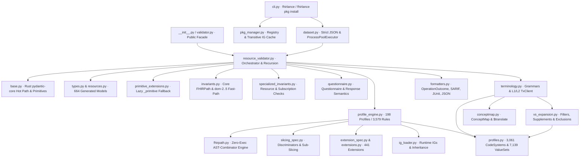

# FHIRlance Architecture & Development Reference

This document describes the **internal module architecture** of `src/fhirlance/` and the **build, code-generation, and local quality-gate workflows**.

For other topics, see:
- **[CLI & Python API Reference](usage.md)**
- **[Terminology Validation Engine & TX Reference](terminology.md)**
- **[Proof of Functional Equivalence & Test Suite Architecture](equivalence-and-testing.md)**
- **[Build & CI/CD Architecture](ci-and-build.md)**
- **[Architecture & Product Roadmap](roadmap.md)**

---

## 1. Package Architecture (`src/fhirlance/`)



| Module | Role & Responsibilities |
| :--- | :--- |
| [`base.py`](../src/fhirlance/base.py) | `FHIRBaseModel` (pure Rust `pydantic-core` hot path with `extra="forbid"`), `ExtensionBase` (`ext-1`), `DomainResourceBase`, and strict FHIR R4 primitive types (`FHIRDate`, `FHIRDateTime`, `FHIRInstant`, `FHIRTime`, `FHIRId`, `FHIRCode`, 32-bit `FHIRInteger` `-2147483648..2147483647`, 1 MB `FHIRString` `max_length=1048576`, `FHIRPositiveInt`, `FHIRUnsignedInt`). |
| [`types.py`](../src/fhirlance/types.py) & [`resources.py`](../src/fhirlance/resources.py) | Auto-generated Pydantic v2 models for all **39 complex datatypes** (including `SimpleQuantity`), **146 FHIR R4 resources**, and BackboneElement sub-models (**664 distinct `BaseModel` subclasses**: `608` in `resources.py`, `57` in `types.py`). Never hand-edit. |
| [`profiles.py`](../src/fhirlance/profiles.py) | Auto-generated Implementation Guide profile constraint definitions (**198 profiles** — `185` resource + `13` complex-type profiles — and **3,579 compiled rules** across 5 IGs), **441 `EXTENSION_CONSTRAINTS`**, **38 `BASE_RESOURCE_CONSTRAINTS`**, and terminology tables (**3,061 `COMPLETE_CODE_SYSTEMS`**, **7,139 `VALUE_SET_SPECS`**, `BASE_RESOURCE_BINDINGS`, `COMPLEX_TYPE_BINDINGS`). Never hand-edit. |
| [`profile_engine.py`](../src/fhirlance/profile_engine.py) | Typed, pre-compiled `StructureDefinition` constraint evaluator (`required`, `forbidden`, `max_one`, `fixed[x]`, `pattern[x]`, `[x]` type narrowing, `Reference.targetProfile` / `aggregation`, `required` / `preferred` ValueSet bindings, `mustSupport`, `max_length`, `value_bounds`, `element_profiles`, FHIRPath `constraints`, and full discriminator slicing). |
| [`fhirpath.py`](../src/fhirlance/fhirpath.py) | Pure-Python, zero-`exec` AST-combinator FHIRPath R4 evaluation engine used for `StructureDefinition.element.constraint` invariants and dynamic profile expressions. |
| [`slicing_spec.py`](../src/fhirlance/slicing_spec.py) | Compiled slicing dataclasses and discriminator evaluators (`value`, `pattern`, `type`, `profile`, `exists`), slice `min`/`max` cardinality, `closed`/`openAtEnd`/`ordered` rules, and nested sub-slicing. |
| [`extension_spec.py`](../src/fhirlance/extension_spec.py) & [`extensions.py`](../src/fhirlance/extensions.py) | First-class Extension `StructureDefinition` compilation and validation (`context`, `value[x]` types & ValueSet bindings, complex sub-extension slices, and `modifierExtension` `isModifier` / unknown-modifier checks). |
| [`ig_loader.py`](../src/fhirlance/ig_loader.py) | Runtime Implementation Guide loader supporting `.tgz` tarballs, unpacked directories, `Bundle`s, `StructureDefinition`s, `ConceptMap`s, and `~/.fhir/packages` / `~/.cache/fhirlance/packages` semver resolution with `baseDefinition` inheritance merging. |
| [`pkg_manager.py`](../src/fhirlance/pkg_manager.py) | FHIR IG package resolver and safe installer (`fhirlance pkg install <id>#<version>`) with recursive `package.json` dependency resolution into `~/.cache/fhirlance/packages/`. |
| [`invariants.py`](../src/fhirlance/invariants.py) | Core FHIRPath invariant dispatchers (`txt-1`, `dom-2`–`dom-5` fast-path for `DomainResource.contained[]`, `pat-1`, `obs-6`, `obs-7`, `con-4`, `bdl-1`–`bdl-5`, `bdl-7`–`bdl-12`). |
| [`specialized_invariants.py`](../src/fhirlance/specialized_invariants.py) | Specialized FHIR R4 resource invariants and `Subscription` semantic checks. |
| [`questionnaire.py`](../src/fhirlance/questionnaire.py) | Semantic validation for FHIR R4 `Questionnaire` (`que-1`–`que-13`, `enableWhen`, `answerValueSet`) and `QuestionnaireResponse` cross-validation (`qrs-1`, `Bundle` / `contained[]` / `questionnaire_resource` resolution). |
| [`primitive_extensions.py`](../src/fhirlance/primitive_extensions.py) | Lazy `_primitive` JSON extension fallback invoked only when `extra="forbid"` encounters a `_field` companion property. |
| [`formatters.py`](../src/fhirlance/formatters.py) | Self-validating FHIR R4 `OperationOutcome`, OASIS SARIF v2.1.0, JUnit XML, JSON, and human-readable text report formatters. |
| [`resource_validator.py`](../src/fhirlance/resource_validator.py) | Single-resource validation orchestrator, single-pass coding/extension traversal, `Bundle` reference symbol table (`fullUrl` / `#contained`), `--best-practice` / `--enforce-must-support` / `--unknown-profile` evaluation, and depth-guarded (`max_depth=16`) recursive `Bundle.entry[].resource` and `DomainResource.contained[]` validator. |
| [`terminology.py`](../src/fhirlance/terminology.py) | Offline grammar validation (UCUM, BCP-47, MIME, ISO-3166), local complete CodeSystems (`3,061`), ValueSet binding validation (`7,139` specs with `url\|version` fallback), and two-tier L1 in-memory / L2 SQLite remote caching client. |
| [`vs_expansion.py`](../src/fhirlance/vs_expansion.py) | Shared ValueSet expansion, `CodeSystem.supplements` merging, hierarchy traversal, `compose.include.filter` operators (`exists`, `generalizes`, `child-of`, `not-in`, `is-a`, `descendent-of`, `is-not-a`, `=`, `in`, `regex`), `compose.exclude`, and `expansion.contains` evaluation. |
| [`conceptmap.py`](../src/fhirlance/conceptmap.py) | FHIR R4 `ConceptMap` parsing, `ConceptMapRegistry` indexing, and local-first / remote-fallback `$translate` evaluation. |
| [`dataset.py`](../src/fhirlance/dataset.py) | Strict JSON (`NaN`/`Infinity`-rejecting) loader, outer `Bundle` validation, and sequential/multi-process (`ProcessPoolExecutor`) dataset runner for `.json`, `.ndjson`, and directories. |
| [`validator.py`](../src/fhirlance/validator.py) | Public validation facade re-exported by `fhirlance`. |
| [`cli.py`](../src/fhirlance/cli.py) | `fhirlance` and `fhirlance pkg` command-line entrypoints. |

---

## 2. Build, Codegen & Local Quality Gate

### 2.1 Schema Compilation & Benchmark Scripts (`scripts/`)

```bash
# Regenerate types.py, resources.py, and profiles.py from ~/.fhir/packages
python scripts/generate_models.py

# Run performance benchmarks and update README.md, docs/equivalence-and-testing.md, and docs/benchmark-results.json
python scripts/benchmark_performance.py --update-docs

# Re-run live HL7 validator_cli.jar baseline benchmark and update docs
python scripts/benchmark_performance.py --run-hl7-live --update-docs
```

### 2.2 Local Development & Quality Gate

Install development dependencies (`ruff`, `mypy`, `pytest-cov`, `hypothesis`, `pip-audit`, `build`, `twine`):
```bash
pip install -e ".[dev]"
```

Run the full local quality gate:
```bash
ruff check .
ruff format --check .
mypy
pytest -m "not hl7_live" --cov --cov-report=term-missing --cov-fail-under=95
pip-audit
```

Run live HL7 `validator_cli.jar` equivalence tests (requires Java + `validator_cli.jar`):
```bash
pytest -m hl7_live -v -s
```
