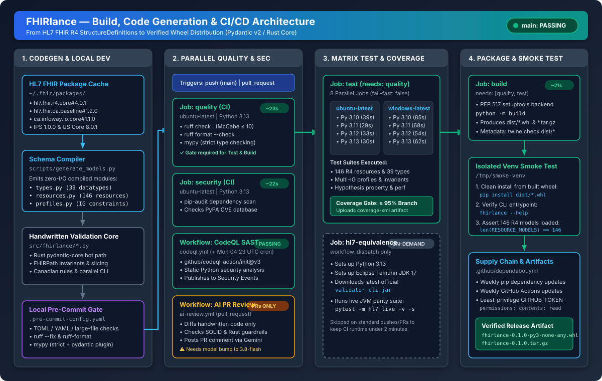
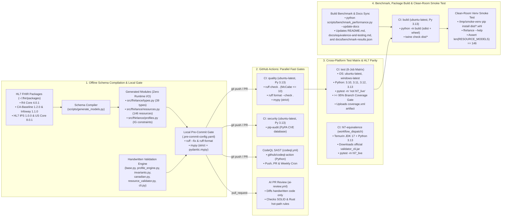

# FHIRlance Build & CI/CD Architecture

This document explains how **FHIRlance** compiles HL7 FHIR R4 specifications into zero-I/O Pydantic v2 models, enforces local developer quality gates, and validates, audits, packages, and smoke-tests distributions in GitHub Actions.

---

## End-to-End Pipeline Flow (Mermaid)

---

## Stage-by-Stage Breakdown

### Phase 1: Offline Schema Compilation (`scripts/generate_models.py`)
FHIRlance avoids parsing multi-megabyte FHIR StructureDefinition JSON files at runtime. Instead, schema compilation happens ahead-of-time via `scripts/generate_models.py`:

1. **Input Packages (`~/.fhir/packages/`)**:
   - `hl7.fhir.r4.core#4.0.1` (Base FHIR R4 specification)
   - `hl7.fhir.ca.baseline#1.2.0` (Canadian Baseline Implementation Guide)
   - `ca.infoway.io.core#1.1.0-dft-preballot` (Canada Health Infoway CA Core+)
   - `hl7.fhir.uv.ips#1.0.0` (HL7 International Patient Summary)
   - `hl7.fhir.us.core.r4#8.0.1` (HL7 US Core)
2. **Generated Artifacts (Committed to `src/fhirlance/`)**:
   - `types.py`: All **39 FHIR R4 complex datatypes** (`Coding`, `CodeableConcept`, `Identifier`, `Period`, `Reference`, etc.).
   - `resources.py`: All **146 FHIR R4 base resources** (`Patient`, `Observation`, `Bundle`, etc.) subclasses of `DomainResourceBase` / `FHIRBaseModel` (`extra="forbid"`, strict R4 regex primitives).
   - `profiles.py`: Pre-compiled Implementation Guide profile constraints with resolved `baseDefinition` inheritance chains (cardinality, `max=0` forbidden elements, `fixed[x]`, `pattern[x]`, `[x]` type narrowing, `Reference.targetProfile`, `binding_specs` preserving parent `required` strength, and slicing definitions), plus precompiled terminology tables: **1,059 `COMPLETE_CODE_SYSTEMS`**, **1,442 `VALUE_SET_SPECS`**, and **146 `BASE_RESOURCE_BINDINGS`**.

> [!IMPORTANT]
> **Engineering Guardrails**:
> 1. **Never hand-edit** `src/fhirlance/types.py`, `src/fhirlance/resources.py`, or `src/fhirlance/profiles.py`. Always regenerate via `python scripts/generate_models.py`.
> 2. **Keep the hot path in Rust (`pydantic-core`)**: `FHIRBaseModel` intentionally omits `@model_validator(mode="before")` so standard JSON payloads validate at native Rust speeds; `_primitive` JSON extensions are handled lazily by `primitive_extensions.py` only when extra keys are rejected.

---

### Phase 2: Local Developer & Pre-Commit Gate (`.pre-commit-config.yaml`)
Before commits leave a developer workstation, `pre-commit` enforces:
- **Repository Hygiene**: `trailing-whitespace`, `end-of-file-fixer`, `check-toml`, `check-yaml`, `check-merge-conflict`, and `check-added-large-files` (`--maxkb=1024`).
- **Linting & Formatting**: `ruff --fix` and `ruff-format` (targeting Python 3.10+, 100-char line length, McCabe complexity ≤ 10, max 5 arguments, max 10 branches, max 35 statements per function).
- **Static Typing**: `mypy` in `strict = true` mode with the `pydantic.mypy` plugin enabled across `src/fhirlance`, `scripts`, and `tests`.

---

### Phase 3: Continuous Integration & Security Workflows (`.github/workflows/`)

#### 1. Main CI Pipeline (`.github/workflows/ci.yml`)
Triggered on `push` to `main`, `pull_request` targeting `main`, and manual `workflow_dispatch`. Uses concurrency cancellation (`cancel-in-progress: true`) and read-only `GITHUB_TOKEN` permissions (`contents: read`).

| Job ID | Runner / Matrix | Dependencies | What It Verifies |
| :--- | :--- | :--- | :--- |
| **`quality`** | `ubuntu-latest` (Python 3.13) | None | Runs `ruff check .`, `ruff format --check .`, and strict `mypy`. Acts as a fast fail gate (~23s) before launching the 8-job test matrix. |
| **`security`** | `ubuntu-latest` (Python 3.13) | None | Runs `pip-audit --progress-spinner off` (~22s) to audit all installed runtime and dev dependencies against the PyPA advisory database for known CVEs. |
| **`test`** | `ubuntu-latest`, `windows-latest` × Python `3.10`, `3.11`, `3.12`, `3.13` (8 jobs) | `needs: quality` | Runs `pytest -m "not hl7_live" --cov --cov-report=xml --cov-report=term-missing --cov-fail-under=95`. Enforces **≥ 95% branch coverage** across all handwritten modules in `src/fhirlance` and uploads `coverage.xml` from `ubuntu-latest` / Python 3.13 (14-day retention). |
| **`build`** | `ubuntu-latest` (Python 3.13) | `needs: [quality, test]` | Runs `python scripts/benchmark_performance.py --update-docs` to refresh the Performance section in `README.md`, `docs/equivalence-and-testing.md`, and `docs/benchmark-results.json`, builds sdist (`.tar.gz`) and wheel (`.whl`) via `python -m build`, validates package metadata with `twine check dist/*`, uploads the `benchmark-results` artifact, and runs a **clean-room smoke test** inside `/tmp/smoke-venv` (`pip install dist/*.whl`, `fhirlance --help`, and `assert len(fhirlance.RESOURCE_MODELS) == 146`). |
| **`hl7-equivalence`** | `ubuntu-latest` (Python 3.13 + Temurin JDK 17) | `if: github.event_name == 'workflow_dispatch'` | Downloads the latest official HL7 `validator_cli.jar` from `hapifhir/org.hl7.fhir.core`, runs `pytest -m hl7_live -v -s` to verify equivalence against the reference Java validator across all 146 R4 resources, and runs `python scripts/benchmark_performance.py --run-hl7-live --update-docs`. |

#### 2. Static Application Security Testing (`.github/workflows/codeql.yml`)
- Runs GitHub **CodeQL** analysis for Python (`github/codeql-action@v3`) on every push to `main`, every pull request targeting `main`, and on a weekly schedule (`23 4 * * 1` — Mondays at 04:23 UTC).
- Reports findings directly to the repository's GitHub **Security** tab (`security-events: write`).

#### 3. Automated AI PR Code Review (`.github/workflows/ai-review.yml`)
- Triggered on `pull_request` (`opened`, `synchronize`, `reopened`) from same-repository branches.
- Computes a unified git diff excluding auto-generated files (`types.py`, `resources.py`, `profiles.py`) and submits it to the Gemini API (`GEMINI_API_KEY` secret) to review for FHIR R4 semantics, SOLID/Clean Code adherence, and the Rust `pydantic-core` hot-path guardrails, posting the review directly as a PR comment.

#### 4. Automated Dependency Maintenance (`.github/dependabot.yml`)
- Configured for weekly automated pull requests across both **`pip`** (`pyproject.toml`) and **`github-actions`** (`.github/workflows/*.yml`).
