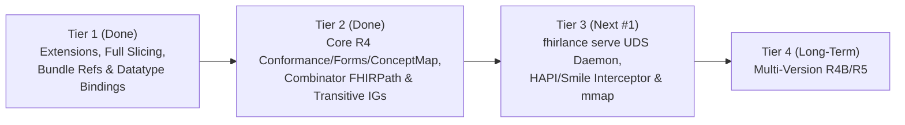

# FHIRlance Roadmap: Footprint-Prioritized Validation & HAPI / Smile CDR Integration

> [!IMPORTANT]
> **Baseline Advantage**: FHIRlance already validates all 146 FHIR R4 resource types, 39 complex datatypes (`661` models incl. `SimpleQuantity`), 198 IG profiles (`3,579` rules), 441 Extension `StructureDefinition`s, full slicing, `Bundle` reference graphs, zero-`exec` AST-combinator FHIRPath invariants, `Questionnaire`/`ConceptMap`, and 3,061 CodeSystems / 7,139 ValueSets at **~122 µs/resource (~8,200 res/s per core)** in-process (`pydantic-core` Rust hot-path) vs. **35.13 s (`102.7 ms/resource`)** for `validator_cli.jar` (**842.2x speedup**).
> **Architecture Decision (Python-First)**: At ~0.12 ms/resource, validation is already faster than downstream FHIR server DB writes and search indexing. Rather than taking on a two-language Rust rewrite (`PyO3`/C-ABI) for academic microsecond gains, FHIRlance stays **Python-first** (`pydantic-core` + pure Python), having completed **conformance completeness** (Tier 2) and now focusing engineering effort on **server/sidecar integration** (Tier 3).
> **Prioritization Principle**: Features are ordered by **real-world FHIR community footprint** — validating the **most widely used structures first** (core clinical resources, extensions, slicing, `Bundle` references, and common IG constraints), **core conformance, form-capture, terminology-mapping, and subscription resources next** (`Questionnaire`/`QuestionnaireResponse`, `CapabilityStatement`, `OperationDefinition`, `SearchParameter`, `ConceptMap`, `Subscription`, plus `TestScript`, `StructureMap`, `GraphDefinition`, `MolecularSequence`, `MedicinalProduct*`, `VerificationResult`), and **multi-version targets** (`R4B`/`R5`) last.

---

## Summary Milestone Matrix (Ordered by FHIR Community Footprint)

| Tier / Phase | Target | Status | Milestone (Most-Used Structures First) | Primary Surface |
| :--- | :---: | :---: | :--- | :--- |
| **Baseline (`v0.1.0`)** | `v0.1.0` | **Done** | 146 R4 Resources, 39 Datatypes, 183 Profiles, Dynamic `-ig`, Local/SQLite TX (`hl7.terminology.r4` + 5 IGs), `OperationOutcome`/SARIF/JUnit | [`resources.py`](../src/fhirlance/resources.py), [`profile_engine.py`](../src/fhirlance/profile_engine.py), [`terminology.py`](../src/fhirlance/terminology.py) |
| **Tier 1 (`v0.2.0`)** | `v0.2.0` | **Done** | **Highest-Footprint Structures**: Extension `StructureDefinition`s, Full Slicing (`type`/`profile`/`exists`, slice `max`, `closed`/`ordered`, nested sub-slicing), `Bundle` Reference/`targetProfile`/`aggregation` Graph & Outer `Bundle` Check, Complex Datatype Bindings (`Identifier.type`, `ContactPoint`, `Address`), Single-Pass Scan | [`extensions.py`](../src/fhirlance/extensions.py), [`slicing_spec.py`](../src/fhirlance/slicing_spec.py), [`profile_engine.py`](../src/fhirlance/profile_engine.py), [`resource_validator.py`](../src/fhirlance/resource_validator.py) |
| **Tier 2 (`v0.3.0`)** | `v0.3.0` | **Done** | **Core R4 Conformance, Forms, Terminology & IG Ecosystem**: `Questionnaire`/`QuestionnaireResponse` (`que-*`, `enableWhen`/`answerOption`), `CapabilityStatement`/`OperationDefinition`/`SearchParameter`, `ConceptMap` (`$translate`), `Subscription`, `TestScript`/`StructureMap`/`GraphDefinition`/`MolecularSequence`/`MedicinalProduct*`/`VerificationResult`; Zero-`exec` AST-Combinator FHIRPath (`fhirpath.py`, `38` base invariant sets / `91` rules), `maxLength`/`minValue`/`maxValue`/`type.profile`, Transitive `package.json` IG Dependencies & `fhirlance pkg install`, Versioned Canonicals (`url\|version`), `CodeSystem.supplements`, `compose.include.filter`/`exclude`/`expansion.contains`, `--best-practice`, `--enforce-must-support`, `--unknown-profile` | [`fhirpath.py`](../src/fhirlance/fhirpath.py), [`specialized_invariants.py`](../src/fhirlance/specialized_invariants.py), [`questionnaire.py`](../src/fhirlance/questionnaire.py), [`conceptmap.py`](../src/fhirlance/conceptmap.py), [`pkg_manager.py`](../src/fhirlance/pkg_manager.py), [`vs_expansion.py`](../src/fhirlance/vs_expansion.py) |
| **Tier 3 (`v0.4.0`)** | `v0.4.0` | **Next (#1)** | **Server & Enterprise Scale**: `fhirlance serve` UDS/HTTP `$validate` Sidecar, **HAPI FHIR / Smile CDR Raw-Byte Interceptor**, Envoy/NGINX Edge Filter, `mmap` Multi-GB NDJSON Streaming | Unix Domain Socket (`/run/fhirlance.sock`), Java HAPI Interceptor |
| **Tier 4 (`v1.0.0`)** | `v1.0.0` | **Long-Term** | **Multi-Version FHIR Support**: `R4B` & `R5` Codegen Targets | [`generate_models.py`](../scripts/generate_models.py), [`resources.py`](../src/fhirlance/resources.py) |

---

## Forensic Audit: Where We Stand Today

| Capability Dimension | Current State in FHIRlance | Remaining Gap vs. `validator_cli.jar` |
| :--- | :--- | :--- |
| **Base R4 Structural** | 146 resources + 39 datatypes (`661` `BaseModel` subclasses: `606` in [`resources.py`](../src/fhirlance/resources.py), `55` in [`types.py`](../src/fhirlance/types.py) incl. `SimpleQuantity`), 32-bit `FHIRInteger` (`-2147483648..2147483647`), 1 MB `FHIRString` (`max_length=1048576`) | **Complete** (`extra="forbid"`, strict primitives, `[x]` exclusivity, `_primitive` extensions). |
| **Terminology** | **3,061** `COMPLETE_CODE_SYSTEMS`, **7,139** `VALUE_SET_SPECS` (with `url\|version` indexing), `CodeSystem.supplements`, `ValueSet.compose.include.filter` (`exists`, `generalizes`, `child-of`, `not-in`, `is-a`, `descendent-of`, `is-not-a`, `=`, `in`, `regex`), `compose.exclude`, `expansion.contains` ([`vs_expansion.py`](../src/fhirlance/vs_expansion.py)), `ConceptMap` & `$translate` ([`conceptmap.py`](../src/fhirlance/conceptmap.py)), `COMPLEX_TYPE_BINDINGS`, offline grammars (UCUM, BCP-47, BCP-13, ISO-3166), L1/L2 SQLite cache, `--tx`, `--strict-extensible`, `--best-practice` (`preferred` bindings) ([`terminology.md`](terminology.md)) | Remote TX-dependent subsumption (`SNOMED CT` ECL / `is-a` without local expansion) when `--tx off`. |
| **Extensions** | First-class Extension `StructureDefinition` validation (`441` `EXTENSION_CONSTRAINTS` + runtime `-ig`) in [`extension_spec.py`](../src/fhirlance/extension_spec.py) & [`extensions.py`](../src/fhirlance/extensions.py) (`ext-1`, `context`, `value[x]`, sub-extensions, `modifierExtension` `isModifier` & unknown modifier rejection) | Arbitrary FHIRPath `ElementDefinition.constraint` rules declared on custom extensions when using unsupported external `resolve()`. |
| **Slicing** | Complete slicing in [`slicing_spec.py`](../src/fhirlance/slicing_spec.py) & [`profile_engine.py`](../src/fhirlance/profile_engine.py): all 5 discriminator types (`value`, `pattern`, `type`, `profile`, `exists`), slice `min`/`max`, `closed`/`openAtEnd`/`ordered`, and nested sub-slicing | — |
| **Profile Engine** | **198** compiled profiles (`185` resource + `13` complex-type profiles, `3,579` rules across R4 Core `49`, CA-Baseline `28`, CA Core `34`, UV IPS `33`, US Core `54`) in [`profiles.py`](../src/fhirlance/profiles.py) + runtime `-ig` with transitive `package.json` dependency resolution ([`ig_loader.py`](../src/fhirlance/ig_loader.py), [`pkg_manager.py`](../src/fhirlance/pkg_manager.py)), `fhirlance pkg install`, `maxLength`, `minValue`/`maxValue`, `type.profile`, `--enforce-must-support`, `--unknown-profile {ignore,warning,error}` | — |
| **Bundles & References** | Outer `Bundle` validation in [`dataset.py`](../src/fhirlance/dataset.py); per-Bundle `fullUrl` & `#contained` symbol table in [`resource_validator.py`](../src/fhirlance/resource_validator.py) & [`profile_engine.py`](../src/fhirlance/profile_engine.py) (`Reference.type`, `targetProfile`, `aggregation`) | External/remote reference resolution beyond `Bundle` & `#contained`. |
| **FHIRPath Invariants** | Zero-`exec` AST-combinator FHIRPath evaluator in [`fhirpath.py`](../src/fhirlance/fhirpath.py) + `38` `BASE_RESOURCE_CONSTRAINTS` (`91` rules) + [`invariants.py`](../src/fhirlance/invariants.py) + `--best-practice` (`dom-6`, `Observation.performer`, `preferred` bindings) | External/remote `resolve()` and rare `ElementDefinition.constraint` functions (`aggregate`, `trc`). |
| **Specialized R4 Resources & Forms** | [`questionnaire.py`](../src/fhirlance/questionnaire.py) (`Questionnaire`/`QuestionnaireResponse` `que-*`, `enableWhen`, `answerOption`, `answerValueSet`), [`specialized_invariants.py`](../src/fhirlance/specialized_invariants.py) (`CapabilityStatement`, `OperationDefinition`, `SearchParameter`, `Subscription`, `TestScript`, `StructureMap`, `GraphDefinition`, `MolecularSequence`, `MedicinalProduct*`, `VerificationResult`), [`conceptmap.py`](../src/fhirlance/conceptmap.py) (`ConceptMap` & `$translate`) | Runtime `StructureMap` `$transform` execution engine. |
| **Output & Server Ecosystem** | `OperationOutcome`, SARIF v2.1.0, JUnit XML, JSON & text ([`formatters.py`](../src/fhirlance/formatters.py)); intra-file multiprocessing ([`dataset.py`](../src/fhirlance/dataset.py)) | `fhirlance serve` UDS/HTTP daemon, HAPI FHIR / Smile CDR raw-byte interceptor, and `mmap` streaming. |

---

## Tier 1: Highest-Footprint Core Structures (`v0.2.0` — Done)

These structures appear in **>80% of real-world FHIR payloads** (US Core, IPS, CA-Baseline, Ontario MI/eReferral `Patient`, `Observation`, `DiagnosticReport`, `Condition`, `ServiceRequest`, `Bundle`). All four pillars are implemented and verified on `main`:

1. **First-Class Extension `StructureDefinition` Validation** *(Done — #17, #18)*
   - Extracts all `StructureDefinition`s where `type == "Extension"` across built-in IGs ([`generate_models.py`](../scripts/generate_models.py)) and runtime `-ig` packages ([`ig_loader.py`](../src/fhirlance/ig_loader.py)).
   - Validates extension `context`, `value[x]` allowed types and ValueSet bindings, complex extension sub-slices, and `modifierExtension` `isModifier` / unknown-modifier rules ([`extension_spec.py`](../src/fhirlance/extension_spec.py), [`extensions.py`](../src/fhirlance/extensions.py)).
2. **Complete Slicing Semantics & Slice `max` Cardinality** *(Done — #21)*
   - Supports all 5 FHIR discriminator types (`value`, `pattern`, `type`, `profile`, `exists`), slice `max`, `closed` / `openAtEnd` / `ordered` rules, and multi-level nested sub-slicing ([`slicing_spec.py`](../src/fhirlance/slicing_spec.py), [`profile_engine.py`](../src/fhirlance/profile_engine.py)).
3. **Bundle Reference Graph, `targetProfile` & Outer `Bundle` Validation** *(Done — #22)*
   - Validates the outer `Bundle` resource in [`dataset.py`](../src/fhirlance/dataset.py) and enforces `bdl-1`–`bdl-5`, `bdl-7`–`bdl-12` in [`invariants.py`](../src/fhirlance/invariants.py).
   - Indexes `entry[].fullUrl` and `contained[].id` (`#id`) to verify `Reference.type`, `targetProfile` conformance, and `type.aggregation` (`contained`, `referenced`, `bundled`).
4. **Complex Datatype Element Bindings & Single-Pass Scan** *(Done — #23, #24)*
   - Extracts and enforces ValueSet bindings declared on the 39 complex datatype `StructureDefinition`s (`COMPLEX_TYPE_BINDINGS`) via single-pass coding/extension traversal in [`resource_validator.py`](../src/fhirlance/resource_validator.py) and [`terminology.py`](../src/fhirlance/terminology.py).

---

## Tier 2: Core R4 Conformance, Forms, Terminology & IG Ecosystem (`v0.3.0` — Done)

All four Tier 2 pillars are implemented and verified on `main` (PRs #26–#29):

1. **Core Specialized FHIR R4 Resources & Terminologies** *(Done — #26)*
   - Validated against production Canadian provincial IGs on Simplifier (**Ontario Health**: eForms SDC, eReferral/eConsult, Ontario Patient Summary, PHSD/PPR, PCR, OLIS, Subscription IG, Ontario Terminology; **British Columbia / PHSA**: BC Core, BC LRA; **Alberta**: PS-AB `ca.ab.fhir.psab`, AB:eReC):
     - **`Questionnaire` / `QuestionnaireResponse`** ([`questionnaire.py`](../src/fhirlance/questionnaire.py)): `que-*` invariants, `enableWhen`, `answerOption` / `answerValueSet` checks.
     - **`CapabilityStatement` / `OperationDefinition` / `SearchParameter` / `Subscription` / Additional R4 Spec Resources** ([`specialized_invariants.py`](../src/fhirlance/specialized_invariants.py)): Server/client conformance, custom operations, search parameters, notification topics / R5-backport subscriptions, plus `TestScript`, `StructureMap`, `GraphDefinition`, `MolecularSequence`, `MedicinalProduct*`, and `VerificationResult`.
     - **`ConceptMap` (`$translate`)** ([`conceptmap.py`](../src/fhirlance/conceptmap.py)): Local/provincial code-system mappings and `$translate` evaluation.
2. **Zero-`exec` AST-Combinator FHIRPath Constraint Evaluator & Best Practices** *(Done — #27)*
   - Safe, zero-`exec` AST-combinator FHIRPath evaluator in [`fhirpath.py`](../src/fhirlance/fhirpath.py) paired with `38` `BASE_RESOURCE_CONSTRAINTS` (`91` rules) and [`invariants.py`](../src/fhirlance/invariants.py) for built-in R4 and runtime `-ig` `ElementDefinition.constraint.expression` rules.
   - Added opt-in `--best-practice` flag for non-blocking HL7 best-practice recommendations (`dom-6` narrative, `Observation.performer`, `preferred` ValueSet bindings).
3. **Remaining `ElementDefinition` Constraints & Base Model Hardening** *(Done — #28)*
   - Extracted and enforced `maxLength`, `minValue[x]` / `maxValue[x]`, `type.profile` (profiled datatypes such as `SimpleQuantity`, `Money`, `Age`, `Duration`), empty-list `min >= 1` edge cases, 32-bit `FHIRInteger` (`-2147483648..2147483647`), 1 MB `FHIRString` (`max_length=1048576`), and optional `--enforce-must-support`.
   - Expanded precompiled profiles to **198** (`185` resource + `13` complex-type profiles, `3,579` rules across R4 Core `49`, CA-Baseline `28`, CA Core `34`, UV IPS `33`, US Core `54`) and **441** `EXTENSION_CONSTRAINTS`.
4. **Transitive IG & Terminology Completeness** *(Done — #29)*
   - Automatic transitive `package.json` `dependencies` resolution in [`ig_loader.py`](../src/fhirlance/ig_loader.py), [`pkg_manager.py`](../src/fhirlance/pkg_manager.py), and [`generate_models.py`](../scripts/generate_models.py), plus persistent disk caching in `~/.cache/fhirlance/packages/` and `fhirlance pkg install <id>#<version>`.
   - Expanded precompiled terminology to **3,061** `COMPLETE_CODE_SYSTEMS` and **7,139** `VALUE_SET_SPECS` with versioned canonicals (`url|version`), `CodeSystem.supplements`, `ValueSet.compose.include.filter` (`exists`, `generalizes`, `child-of`, `not-in`, `is-a`, `descendent-of`, `is-not-a`, `=`, `in`, `regex`), `compose.exclude`, `expansion.contains` ([`vs_expansion.py`](../src/fhirlance/vs_expansion.py)), and configurable `--unknown-profile {ignore,warning,error}`.

---

## Tier 3: Server Sidecar, HAPI / Smile CDR & Enterprise Scale (`v0.4.0` — Next #1)

1. **`fhirlance serve` — Persistent `$validate` Sidecar Daemon**
   - **Unix Domain Sockets** (`fhirlance serve --uds /run/fhirlance.sock`) and HTTP (`--host 127.0.0.1 --port 8080`) with pre-forked workers (`--workers N`).
   - Exposes `POST /$validate`, `POST /{resourceType}/$validate`, `POST /$validate-batch`, `GET /healthz`, `GET /igs`, `HTTP 204 No Content` / `HTTP 422` fast paths, `validate_resource_detailed()`, and `--watch`.
2. **HAPI FHIR / Smile CDR Raw-Byte Interceptor & Edge Filter**
   - Hooks `Pointcut.SERVER_INCOMING_REQUEST_POST_PROCESSED` (and Smile CDR `CHANNEL_IMPORT`) to stream raw UTF-8 request bytes over UDS to `fhirlance serve` before Jackson/DOM parsing or `FhirInstanceValidator` runs (`< 0.3 ms`).
   - Reference Envoy / NGINX edge filter configs and Kubernetes sidecar / Docker Compose manifests.
3. **Memory-Mapped (`mmap`) Streaming NDJSON**
   - Byte-offset chunking for multi-gigabyte `.ndjson` files with `--stream` $O(1)$-memory output.

---

## Tier 4: Multi-Version FHIR Support (`v1.0.0`)

Long-term multi-version platform target:

1. **Multi-Version FHIR Support (`R4B` & `R5`)**
   - Parameterize [`generate_models.py`](../scripts/generate_models.py) to emit versioned schema modules (`fhirlance.r4`, `fhirlance.r4b`, `fhirlance.r5`).

> [!NOTE]
> **Deferred: Native Rust C-ABI (`libfhirlance`) + Java Panama FFI**
> A standalone Rust rewrite (`libfhirlance` + `PyO3` + `java.lang.foreign.Linker`) is **intentionally deferred**. At ~122 µs/resource (~8,200 res/s per core), Python + `pydantic-core` already outperforms downstream FHIR server database writes and search indexing; keeping the validation engine in pure Python avoids a two-language maintenance tax and cross-platform native wheel complexity. Revisit only if a concrete deployment requires zero-sidecar in-process JVM embedding without `fhirlance serve`.

---

## License
Copyright (c) 2026 **Brightwood Consulting Group Limited**. Licensed under **[CC BY-NC 4.0](../LICENSE)**.
