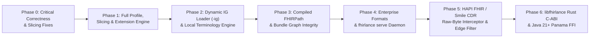
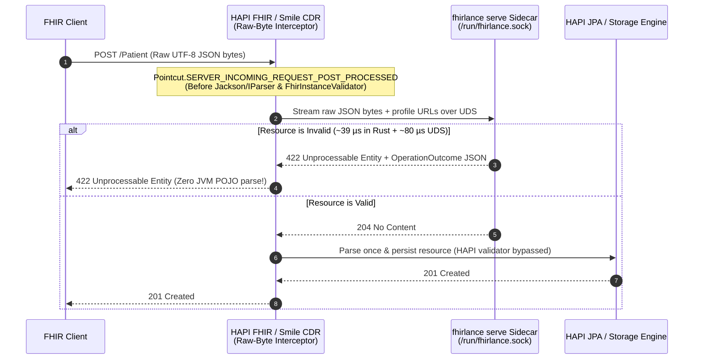

# FHIRlance Roadmap: Superseding the HL7 IG Validator & HAPI / Smile CDR Validation Plane

> [!IMPORTANT]
> **Baseline Advantage**: FHIRlance already validates all 146 FHIR R4 resource types and 39 complex datatypes at **~27,800 resources/sec (`~36–39 µs/resource`)** in-process (`pydantic-core` Rust hot-path) vs. **~35.1s (`108 ms/resource`)** for `validator_cli.jar` (**~2,766x–3,010x faster**). To supersede `validator_cli.jar` and `FhirInstanceValidator` across both standalone pipelines and **HAPI FHIR / Smile CDR** servers, this roadmap closes the remaining semantic validation gaps while providing zero-JVM-overhead integration surfaces.

---

## Summary Milestone Matrix

| Phase | Target | Status | Milestone | Primary Integration Surface | Target Latency / Resource |
| :--- | :---: | :---: | :--- | :--- | ---: |
| **Phase 0** | `v0.1.x` | **In Progress** | Core Correctness, Colon Sub-Slice Resolution & Terminology Bindings | [`profile_engine.py`](../src/fhirlance/profile_engine.py), [`dataset.py`](../src/fhirlance/dataset.py) | **`~36 µs`** |
| **Phase 1** | `v0.2.0` | **Planned** | Complete Slicing (`type`/`profile`/`exists`), Extension `StructureDefinition`s & JHN Checksums | [`generate_models.py`](../scripts/generate_models.py), [`canadian.py`](../src/fhirlance/canadian.py) | **`~40 µs`** |
| **Phase 2** | `v0.2.0` | **In Progress** | Dynamic `-ig` Package Loader *(Done)* & Local/SQLite Terminology Engine (`terminology.py`) | [`ig_loader.py`](../src/fhirlance/ig_loader.py), [`terminology.py`](../src/fhirlance/terminology.py) | **`~45 µs`** (local `-tx`) |
| **Phase 3** | `v0.3.0` | **Planned** | Compiled FHIRPath AST Engine, Bundle Graph Resolution & R4B/R5 Targets | [`invariants.py`](../src/fhirlance/invariants.py), [`resource_validator.py`](../src/fhirlance/resource_validator.py) | **`~50 µs`** |
| **Phase 4** | `v0.3.0` | **Partial (`v0.1.0`)** | `OperationOutcome` / SARIF / JUnit *(Done)* + Persistent `fhirlance serve` `$validate` Daemon | Unix Domain Socket (`/run/fhirlance.sock`) & HTTP `POST /$validate` | **`~150–250 µs`** over UDS |
| **Phase 5** | `v0.4.0` | **Planned** | **HAPI FHIR / Smile CDR Raw-Byte Interceptor** & Envoy / NGINX Edge Filter | `Pointcut.SERVER_INCOMING_REQUEST_POST_PROCESSED` UDS Sidecar | **`< 0.3 ms`** inside HAPI / Smile |
| **Phase 6** | `v1.0.0` | **Long-Term** | **Native Rust Shared Library (`libfhirlance`) + Java 21+ Panama FFI** & 100k+ res/s Streaming | In-process off-heap JVM `MemorySegment` (`java.lang.foreign.Linker`) | **`~20–35 µs`** in-process JVM |

---

## Forensic Audit: Where We Stand Today

| Capability Dimension | Current State in FHIRlance | Remaining Gap vs. `validator_cli.jar` |
| :--- | :--- | :--- |
| **Base R4 Structural** | 146 resources + 39 datatypes in [`resources.py`](../src/fhirlance/resources.py) & [`types.py`](../src/fhirlance/types.py) | **Complete** (`extra="forbid"`, strict primitives, `[x]` exclusivity, `_primitive` extensions). |
| **Profile Engine** | 183 compiled profiles in [`profiles.py`](../src/fhirlance/profiles.py) & [`profile_engine.py`](../src/fhirlance/profile_engine.py) + runtime `-ig` in [`ig_loader.py`](../src/fhirlance/ig_loader.py) | Unknown profile URLs are silently ignored; `maxLength`, `minValue`/`maxValue`, `mustSupport`, and `type.profile` are dropped. |
| **Slicing** | `fixed` and `pattern` discriminators with `:sliceName` path stripping ([`profile_engine.py`](../src/fhirlance/profile_engine.py)) | Slice `max` cardinality is dropped; `type`/`profile`/`exists` discriminators & `closed`/`ordered` slicing unsupported. |
| **Terminology** | Static R4 `code` string sets + standalone [`terminology.py`](../src/fhirlance/terminology.py) (UCUM, BCP-47, BCP-13, ISO-3166, L1/SQLite cache) | Wire `validate_binding_value` & multi-IG `ValueSet`/`CodeSystem` tables into `profile_engine.py` and CLI (`--tx`). |
| **Extensions** | Generic `ext-1` only ([`base.py`](../src/fhirlance/base.py)) | Compile Extension `StructureDefinition`s (`value[x]` types, sub-extension slices, `context`, and `modifierExtension` rules). |
| **FHIRPath Invariants** | 10 compiled invariant checks in [`invariants.py`](../src/fhirlance/invariants.py) | Add general FHIRPath-to-Python compiler for `dom-1..6`, `ref-1`, `que-*`, and IG differential `ElementDefinition.constraint` expressions. |
| **Bundles & References** | Entry & `contained[]` recursion in [`resource_validator.py`](../src/fhirlance/resource_validator.py) | Validate outer `Bundle` in dataset runner; add `#contained` and `urn:uuid:` `fullUrl` graph resolution for `targetProfile` conformance. |
| **Output & Server Ecosystem** | Self-validating FHIR R4 `OperationOutcome`, SARIF v2.1.0, JUnit XML, JSON & text ([`formatters.py`](../src/fhirlance/formatters.py)); intra-file multiprocessing ([`dataset.py`](../src/fhirlance/dataset.py)) | Add `fhirlance serve` persistent UDS/HTTP daemon, HAPI FHIR / Smile CDR raw-byte interceptor, and Rust C-ABI / Panama FFI binding. |

---

## Phase 0: Immediate Correctness & Reliability Fixes (P0 Bugs)

> [!CAUTION]
> Auditing [`profile_engine.py`](../src/fhirlance/profile_engine.py), [`dataset.py`](../src/fhirlance/dataset.py), and [`generate_models.py`](../scripts/generate_models.py) surfaced **6 high-impact correctness gaps** where invalid resources can silently pass or valid profiled resources can fail.

1. **Fix `CodeableConcept` & `Coding` Terminology Binding Bypass** ([`profile_engine.py`](../src/fhirlance/profile_engine.py))
   - `_check_bindings` previously checked `if isinstance(val, str)`, skipping `CodeableConcept` (e.g., `Condition.clinicalStatus`, `Observation.code`) and `Coding` elements.
   - **Fix**: Route through `validate_binding_value()` in [`terminology.py`](../src/fhirlance/terminology.py) to inspect `str`, `Coding.code` (+ `system`), and `CodeableConcept.coding[].code`.
2. **Load Multi-IG ValueSets & CodeSystems in Codegen** ([`generate_models.py`](../scripts/generate_models.py))
   - Expand `CodeSystem` and `ValueSet` resources across all `IG_PKGS` (`compose.include.concept`, `compose.include.system`, and `compose.include.valueSet` imports).
3. **Fix Sub-Slice Path Resolution Bug (e.g., Blood Pressure `coding:SBPCode`)** *(Delivered in `v0.1.0`)*
   - Strip `:SliceName` qualifiers from segment keys in `CompiledSlice.matchers` and `ig_loader.py`.
4. **Enforce Outer `Bundle` Validation in Dataset Runner** ([`dataset.py`](../src/fhirlance/dataset.py))
   - Validate the outer `Bundle` resource (`bdl-1`, `bdl-3`, `bdl-4`, `bdl-7`, and Bundle profiles) when unwrapping `Bundle.entry[].resource`.
5. **Fix Empty-List `min >= 1` Bypass & Slice `max` Cardinality Drop** ([`profile_engine.py`](../src/fhirlance/profile_engine.py))
   - Reject empty lists `[]` in `_check_child_present`, and preserve/enforce `max_count: int | None` in `CompiledSlice`.
6. **Flag Unknown Declared / Requested Profiles** ([`profile_engine.py`](../src/fhirlance/profile_engine.py))
   - Emit a configurable warning/error issue (`unknown-profile`) when a `meta.profile` or `--profile` URL is unknown.

---

## Phase 1: Complete Slicing, Extension & Element Constraint Engine (`v0.2.0`)

To achieve 100% structural/profile parity with `validator_cli.jar` on US Core, IPS, and CA-Baseline:

1. **Full Slicing Semantics** ([`profile_engine.py`](../src/fhirlance/profile_engine.py))
   - Support all 5 FHIR discriminator types: `value` (`fixed[x]`), `pattern` (`pattern[x]`), `type` (`$this` / polymorphic type check), `profile` (`validate_single_profile` match), and `exists` (presence/absence of path).
   - Enforce slicing rules: `closed` (reject elements matching no defined slice), `openAtEnd` (unmatched elements must appear after matched slices), and `ordered: true` (slices must appear in declared order).
2. **First-Class Extension `StructureDefinition` Validation** ([`generate_models.py`](../scripts/generate_models.py), [`profile_engine.py`](../src/fhirlance/profile_engine.py))
   - Extract all `StructureDefinition`s where `type == "Extension"` across R4 Core, US Core, IPS, CA-Baseline, and PS-CA.
   - Validate extension `context` (allowed host paths/resources), `value[x]` allowed types and bindings, and complex extension sub-slices (`extension:ombCategory`, `extension:text`, etc.).
   - Enforce `modifierExtension` rules: verify `isModifier == True` on the definition and flag unknown modifier extensions.
3. **Remaining `ElementDefinition` Constraints**
   - Extract and enforce `maxLength`, `minValue[x]` / `maxValue[x]`, `type.profile` (profiled datatypes like `SimpleQuantity` or `Money`), and optional `--enforce-must-support` validation.
4. **Canadian JHN Checksum & Identifier Formatting** ([`canadian.py`](../src/fhirlance/canadian.py))
   - Add province-specific JHN format and Luhn/Mod-10 checksum verification (Ontario OHIP 10-digit, BC PHN 10-digit Mod-11, Alberta 9-digit, Quebec RAMQ 4-alpha + 8-digit, Nova Scotia 10-digit, etc.).

---

## Phase 2: Dynamic IG Package Manager & Local Terminology Engine (`v0.2.0`)

1. **Dynamic `-ig` Loader & Package Cache Resolver** *(Core delivered in [`ig_loader.py`](../src/fhirlance/ig_loader.py))*
   - Supports `--ig <package#version | path/to/package.tgz | path/to/dir | path/to/file.json>` on the CLI and Python API with in-memory `(st_mtime_ns, st_size)` fingerprinting.
   - Next: persistent disk cache in `~/.cache/fhirlance/` and `fhirlance pkg install <id>#<version>` to fetch directly from `packages.fhir.org` without Java or Node.
2. **Embedded Zero-Latency Terminology Engine** *(Delivered in [`terminology.py`](../src/fhirlance/terminology.py))*
   - Built-in offline grammar validators for **UCUM** (`http://unitsofmeasure.org`), **BCP-47** (`urn:ietf:bcp:47`), **BCP-13 MIME**, and **ISO-3166** country/subdivision codes.
   - Two-tier terminology client (`TxClient`): L1 in-memory LRU cache + L2 SQLite WAL-mode persistent cache (`~/.fhir/fhirlance-tx-cache.sqlite`) with optional remote `$validate-code` fallback.
   - Complete CodeSystem tables (`COMPLETE_CODE_SYSTEMS`) and ValueSet expansion tables (`VALUE_SET_SPECS`) precompiled across R4 Core and all 5 IGs.
   - Integrated `--tx` (`local` [default], `remote`, `off`) and `--strict-extensible` options wired into `profile_engine.py`, `resource_validator.py`, `dataset.py`, `formatters.py`, and `cli.py`.

---

## Phase 3: Compiled FHIRPath Engine, Bundle Graph Integrity & R4B/R5 (`v0.3.0`)

1. **FHIRPath-to-Python Bytecode Compiler**
   - Build a lightweight **FHIRPath AST compiler** that compiles standard R4 + IG `ElementDefinition.constraint.expression` strings directly into fast Python callables at codegen/IG-load time.
   - Cover 100% of R4 base invariants (`dom-1..6`, `ele-1`, `ext-1`, `ref-1`, `bdl-1..12`, `obs-*`, `que-*`, `med-*`, `us-core-*`, `ips-*`).
2. **Bundle Graph & Reference Resolution Engine**
   - Build a per-Bundle symbol table indexing `entry[].fullUrl` (`urn:uuid:...`, `urn:oid:...`, `ResourceType/id`, absolute URLs) and `contained[].id` (`#id`).
   - Resolve intra-Bundle and contained references to their target JSON objects and verify **`targetProfile` conformance** (e.g., verifying that `Observation.subject` inside a Bundle conforms to `ca-baseline-patient` or `us-core-patient`).
   - Enforce `type.aggregation` rules (`contained`, `referenced`, `bundled`) and contained resource invariants (`dom-2`, `dom-3`, `dom-4`).
3. **Multi-Version FHIR Support (`R4B` & `R5`)**
   - Parameterize [`generate_models.py`](../scripts/generate_models.py) to emit versioned schema modules (`fhirlance.r4`, `fhirlance.r4b`, `fhirlance.r5`).

---

## Phase 4: Enterprise Formats & Persistent `$validate` Daemon (`v0.3.0`)

1. **Standard FHIR `OperationOutcome` & CI Formats** *(Delivered in `v0.1.0` — [`formatters.py`](../src/fhirlance/formatters.py))*
   - `--format operation-outcome` (`validate_to_operation_outcome`), `--format sarif` (SARIF v2.1.0), and `--format junit` (JUnit XML).
2. **`fhirlance serve` — Persistent `$validate` Sidecar Daemon**
   - Supports **Unix Domain Sockets** (`fhirlance serve --uds /run/fhirlance.sock`) for zero-network-stack pod-local IPC alongside HTTP (`--host 127.0.0.1 --port 8080`) and pre-forked workers (`--workers N`).
   - Exposes `POST /$validate`, `POST /{resourceType}/$validate`, `POST /$validate-batch` (NDJSON / Bundle streaming), `GET /healthz`, and `GET /igs`.
   - Supports fast pass-through headers (`HTTP 204 No Content` when valid, `HTTP 422 Unprocessable Entity` with `application/fhir+json` `OperationOutcome` when invalid) to eliminate response serialization overhead on the happy path.
   - Target latency: **`~150–250 µs` per resource** over local UDS.
3. **Structured Issue Taxonomy & Watch Mode**
   - Provide `validate_resource_detailed()` returning structured `ValidationIssue` dataclasses (`error`, `warning`, `information`, FHIRPath location) and `fhirlance --watch <dir>` for interactive IG authoring.

---

## Phase 5: HAPI FHIR & Smile CDR High-Speed Integration (`v0.4.0`)

### Why HAPI FHIR & Smile CDR Need an External Fast Path

The default validator inside HAPI FHIR and Smile CDR (`RequestValidatingInterceptor` backed by `FhirInstanceValidator` / `org.hl7.fhir.core`) executes three expensive operations on the JVM heap for every incoming request:
1. **Full POJO Deserialization**: Parses raw UTF-8 JSON bytes into HAPI `IBaseResource` Java objects via Jackson/Gson.
2. **DOM Re-Parsing**: Converts or re-parses the resource into `org.hl7.fhir.r5.elementmodel.Element` trees for `InstanceValidator`.
3. **Interpretive Profile Traversal**: Evaluates `StructureDefinition` snapshots and FHIRPath expressions interpretively across thousands of short-lived Java allocations, driving JVM garbage collection spikes and **`10–100+ ms` per-resource latency**.

> [!WARNING]
> **Anti-Patterns to Avoid When Integrating FHIRlance with Java / HAPI**:
> - **Never spawn the `fhirlance` CLI per HTTP request** (`ProcessBuilder`): Python interpreter startup and module import (`~150–300 ms`) erase FHIRlance's `39 µs` validation speed.
> - **Never run FHIRlance inside an embedded JVM Python interpreter** (Jython, GraalPy, or Jep): `pydantic-core` is a native Rust extension, and sharing process space or GIL locks with JVM request threads degrades throughput and stability.
> - **Never deserialize into `IBaseResource` just to re-serialize to JSON for validation**: Intercept the raw request byte stream before HAPI's parser runs.

### Architecture: Raw-Byte HAPI Interceptor + UDS Sidecar

### Phase 5 Deliverables
1. **HAPI FHIR / Smile CDR Raw-Byte Interceptor (`fhirlance-hapi-interceptor`)**:
   - Hooks `Pointcut.SERVER_INCOMING_REQUEST_POST_PROCESSED` (and Smile CDR `CHANNEL_IMPORT`) to read the incoming `HttpServletRequest` byte buffer before HAPI's `IParser` or `RequestValidatingInterceptor` executes.
   - Streams raw UTF-8 JSON bytes over JDK 16+ native `UnixDomainSocketAddress` (`java.nio.channels.SocketChannel`) to `/run/fhirlance.sock`.
   - Short-circuits invalid requests by throwing `UnprocessableEntityException` populated with the `OperationOutcome` returned by FHIRlance, completely eliminating `FhirInstanceValidator` CPU and GC overhead.
   - Registers a drop-in `@Operation(name = "$validate")` provider that delegates `$validate` operations directly to the sidecar.
2. **Envoy / NGINX Edge Validation Filter**:
   - Reference configuration for offloading `POST`, `PUT`, and `$validate` validation at the reverse-proxy layer so invalid traffic never reaches the JVM thread pool.
3. **Kubernetes Sidecar & Docker Compose Templates**:
   - Production Helm/Compose templates sharing an in-memory `emptyDir: { medium: Memory }` volume for `/run/fhirlance.sock`.

---

## Phase 6: Native Rust Shared Library (`libfhirlance`), Java Panama FFI & 100k+ res/s (`v1.0.0`)

For ultra-low-latency JVM environments that want in-process execution with zero sidecar processes and zero IPC overhead, alongside extreme batch throughput:

1. **Standalone Rust Validation Crate (`libfhirlance`)**:
   - Extend [`generate_models.py`](../scripts/generate_models.py) to emit a pure-Rust validation crate (`serde` + compiled `StructureDefinition` constraint tables + invariant evaluators) compiled to a C-ABI shared library (`libfhirlance.so` / `.dylib` / `.dll`) and Python wheel (`PyO3`).
2. **Java 21+ Project Panama Binding (`java.lang.foreign`)**:
   - Provide a zero-dependency Java 21+ wrapper using the Foreign Function & Memory API (`Linker.nativeLinker()`, `MemorySegment`) to pass off-heap UTF-8 request buffers directly to `libfhirlance` inside the HAPI/Smile JVM process at **`~20–35 µs` per resource** with zero JVM garbage collection impact.
3. **Direct Rust `jiter` / `mmap` Streaming & Zero-Exclusion Live Equivalence**:
   - Memory-mapped (`mmap`) byte-offset chunking for multi-gigabyte `.ndjson` files with `--stream` O(1) memory output and direct `model_validate_json` byte validation.
   - Zero-exclusion live `validator_cli.jar` equivalence gate across all 146 R4 resources and all 5 IGs including terminology and reference resolution.

---

## License
Copyright (c) 2026 **Brightwood Consulting Group Limited**. Licensed under **[CC BY-NC 4.0](../LICENSE)**.
