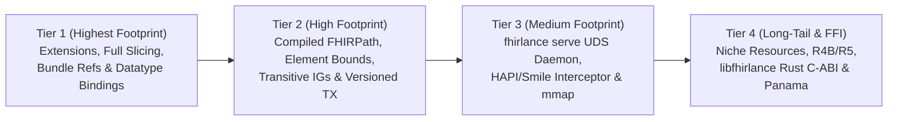

# FHIRlance Roadmap: Footprint-Prioritized Validation & HAPI / Smile CDR Integration

> [!IMPORTANT]
> **Baseline Advantage**: FHIRlance already validates all 146 FHIR R4 resource types, 39 complex datatypes, 183 IG profiles, and 1,161 CodeSystems / 3,297 ValueSets at **~40–80 µs/resource** in-process (`pydantic-core` Rust hot-path) vs. **~20–35s (`108 ms/resource`)** for `validator_cli.jar`.
> **Prioritization Principle**: Features are ordered by **real-world FHIR community footprint** — validating the **most widely used structures first** (core clinical resources, extensions, slicing, `Bundle` references, and common IG constraints) and **less used / long-tail structures last** (`Questionnaire` `que-*`, `CapabilityStatement`, `MedicinalProduct*`, `ConceptMap`, `R4B`/`R5`).

---

## Summary Milestone Matrix (Ordered by FHIR Community Footprint)

| Tier / Phase | Target | Status | Milestone (Most-Used Structures First) | Primary Surface |
| :--- | :---: | :---: | :--- | :--- |
| **Baseline (`v0.1.0`)** | `v0.1.0` | **Done** | 146 R4 Resources, 39 Datatypes, 183 Profiles, Dynamic `-ig`, Local/SQLite TX (`hl7.terminology.r4` + 5 IGs), `OperationOutcome`/SARIF/JUnit | [`resources.py`](../src/fhirlance/resources.py), [`profile_engine.py`](../src/fhirlance/profile_engine.py), [`terminology.py`](../src/fhirlance/terminology.py) |
| **Tier 1 (`v0.2.0`)** | `v0.2.0` | **Next (#1)** | **Highest-Footprint Structures**: Extension `StructureDefinition`s, Full Slicing (`type`/`profile`/`exists`, slice `max`, `closed`/`ordered`), `Bundle` Reference/`targetProfile` Graph & Outer `Bundle` Dataset Check, Complex Datatype Bindings (`Identifier.type`, `ContactPoint`, `Address`) | [`generate_models.py`](../scripts/generate_models.py), [`profile_engine.py`](../src/fhirlance/profile_engine.py), [`resource_validator.py`](../src/fhirlance/resource_validator.py) |
| **Tier 2 (`v0.3.0`)** | `v0.3.0` | **Planned** | **High-Footprint Conformance**: General FHIRPath AST Compiler (`ElementDefinition.constraint`), `maxLength`/`minValue`/`maxValue`/`type.profile`, Transitive `package.json` IG Dependencies, Versioned Canonicals (`url\|version`), `--best-practice` (`dom-6`), `--enforce-must-support`, `unknown-profile` | [`invariants.py`](../src/fhirlance/invariants.py), [`ig_loader.py`](../src/fhirlance/ig_loader.py), [`terminology.py`](../src/fhirlance/terminology.py) |
| **Tier 3 (`v0.4.0`)** | `v0.4.0` | **Planned** | **Server & Enterprise Scale**: `fhirlance serve` UDS/HTTP `$validate` Sidecar, **HAPI FHIR / Smile CDR Raw-Byte Interceptor**, Envoy/NGINX Edge Filter, `mmap` Multi-GB NDJSON Streaming | Unix Domain Socket (`/run/fhirlance.sock`), Java HAPI Interceptor |
| **Tier 4 (`v1.0.0`)** | `v1.0.0` | **Long-Term** | **Long-Tail Structures & Native FFI**: Niche Resources (`que-*`, `CapabilityStatement`, `TestScript`, `ConceptMap`, `MedicinalProduct*`), `R4B`/`R5` Targets, **`libfhirlance` Rust C-ABI + Java 21+ Panama FFI** | `java.lang.foreign.Linker` off-heap `MemorySegment` |

---

## Forensic Audit: Where We Stand Today

| Capability Dimension | Current State in FHIRlance | Remaining Gap vs. `validator_cli.jar` |
| :--- | :--- | :--- |
| **Base R4 Structural** | 146 resources + 39 datatypes in [`resources.py`](../src/fhirlance/resources.py) & [`types.py`](../src/fhirlance/types.py) | **Complete** (`extra="forbid"`, strict primitives, `[x]` exclusivity, `_primitive` extensions). |
| **Terminology** | **1,161** complete CodeSystems (incl. `hl7.terminology.r4#6.2.0` UTG), **3,297** ValueSets, offline grammars (UCUM, BCP-47, BCP-13, ISO-3166), L1/L2 SQLite cache, `--tx`, `--strict-extensible` ([`terminology.md`](terminology.md)) | Complex datatype element bindings (`Identifier.type`, `ContactPoint`, `Address`), versioned canonicals (`url\|version`), `CodeSystem.supplements`, `exists`/`generalizes`/`child-of` filters, `ConceptMap`/`$translate`, and `--best-practice` (`preferred` bindings). |
| **Extensions** | Generic `ext-1` invariant only ([`base.py`](../src/fhirlance/base.py)) | Compile Extension `StructureDefinition`s (`context`, `value[x]` types/bindings, sub-extension slices, `modifierExtension` `isModifier` checks, unknown modifier rejection). |
| **Slicing** | `fixed` and `pattern` discriminators with `:sliceName` path stripping ([`profile_engine.py`](../src/fhirlance/profile_engine.py)) | Slice `max` cardinality, `type`/`profile`/`exists` discriminators, `closed`/`openAtEnd`/`ordered` rules, and multi-level nested sub-slicing. |
| **Profile Engine** | 183 compiled profiles in [`profiles.py`](../src/fhirlance/profiles.py) + runtime `-ig` in [`ig_loader.py`](../src/fhirlance/ig_loader.py) | Transitive `package.json` IG `dependencies` auto-resolution, `fhirlance pkg install`, `unknown-profile` warning/error, `maxLength`, `minValue`/`maxValue`, `type.profile`, and `--enforce-must-support`. |
| **Bundles & References** | Entry & `contained[]` recursion in [`resource_validator.py`](../src/fhirlance/resource_validator.py) | Validate outer `Bundle` in `dataset.py`; resolve `#contained` & `entry[].fullUrl` (`urn:uuid:...`, `ResourceType/id`) for `Reference.type`, `targetProfile`, and `aggregation`. |
| **FHIRPath Invariants** | 10 compiled invariant checks in [`invariants.py`](../src/fhirlance/invariants.py) | General FHIRPath-to-Python compiler for `dom-1..6`, `ref-1`, `bdl-1..12`, `obs-*`, `pat-*`, `que-*`, and arbitrary IG `ElementDefinition.constraint` rules. |
| **Output & Server Ecosystem** | `OperationOutcome`, SARIF v2.1.0, JUnit XML, JSON & text ([`formatters.py`](../src/fhirlance/formatters.py)); intra-file multiprocessing ([`dataset.py`](../src/fhirlance/dataset.py)) | `fhirlance serve` UDS/HTTP daemon, HAPI FHIR / Smile CDR raw-byte interceptor, `mmap` streaming, and Rust C-ABI / Panama FFI. |

---

## Tier 1: Highest-Footprint Core Structures (`v0.2.0` — Priority #1)

These structures appear in **>80% of real-world FHIR payloads** (US Core, IPS, CA-Baseline, Ontario MI/eReferral `Patient`, `Observation`, `DiagnosticReport`, `Condition`, `ServiceRequest`, `Bundle`).

1. **First-Class Extension `StructureDefinition` Validation** *(Highest Footprint)*
   - Extract all `StructureDefinition`s where `type == "Extension"` across built-in IGs (`generate_models.py`) and runtime `-ig` packages (`ig_loader.py`).
   - Validate extension `context` (allowed host resources/paths), `value[x]` allowed types and ValueSet bindings, and complex extension sub-slices (e.g., `us-core-race`, `us-core-ethnicity`, `data-absent-reason`, provincial extensions).
   - Enforce `modifierExtension` rules: verify `isModifier == True` on known definitions and reject unknown `modifierExtension` URLs.
2. **Complete Slicing Semantics & Slice `max` Cardinality**
   - Support all 5 FHIR discriminator types: `value` (`fixed[x]`), `pattern` (`pattern[x]`), `type` (`$this` / polymorphic type), `profile` (`validate_single_profile` match), and `exists` (presence/absence of sub-element).
   - Preserve and enforce `max_count: int | None` in `CompiledSlice`, plus `closed` (reject unmatched items), `openAtEnd` (unmatched items after matched slices), `ordered: true`, and multi-level nested sub-slicing (`Observation.component`, `Patient.identifier`, `DiagnosticReport.category`).
3. **Bundle Reference Graph, `targetProfile` & Outer `Bundle` Validation**
   - Validate the outer `Bundle` resource (`bdl-1..7`, Bundle profiles) when `dataset.py` unwraps `Bundle.entry[].resource`.
   - Build a per-Bundle symbol table indexing `entry[].fullUrl` (`urn:uuid:...`, `urn:oid:...`, `ResourceType/id`, absolute URLs) and `contained[].id` (`#id`).
   - Resolve intra-Bundle and `#contained` references to verify `Reference.type`, **`targetProfile` conformance** (e.g., `DiagnosticReport.result` → `Observation`, `Observation.subject` → `Patient`), and `type.aggregation` (`contained`, `referenced`, `bundled`).
4. **Complex Datatype Element Bindings**
   - Extract and enforce ValueSet bindings declared on the 39 complex datatype `StructureDefinition`s themselves (e.g., `Identifier.type`, `ContactPoint.system`/`use`, `HumanName.use`, `Address.use`/`type`/`country`), closing gaps such as `ServiceRequest.requisition.type` (`Identifier.type`).

---

## Tier 2: High-Footprint Conformance, FHIRPath & IG Ecosystem (`v0.3.0`)

1. **General FHIRPath-to-Python Constraint Compiler**
   - Compile standard R4 and IG `ElementDefinition.constraint.expression` strings directly into fast Python callables at codegen/IG-load time (`dom-1..6`, `ele-1`, `ref-1`, `bdl-1..12`, `obs-*`, `pat-*`, `con-*`, `med-*`, `us-core-*`, `ips-*`).
   - Add opt-in `--best-practice` flag for non-blocking HL7 best-practice recommendations (`dom-6` narrative, `Observation.performer`, `preferred` ValueSet bindings).
2. **Remaining `ElementDefinition` Constraints**
   - Extract and enforce `maxLength`, `minValue[x]` / `maxValue[x]`, `type.profile` (profiled datatypes such as `SimpleQuantity`, `Money`, `Age`, `Duration`), empty-list `min >= 1` edge cases, and optional `--enforce-must-support`.
3. **Transitive IG & Terminology Completeness**
   - Automatically resolve transitive `package.json` `dependencies` in `ig_loader.py` and `generate_models.py`, plus persistent disk caching in `~/.cache/fhirlance/` and `fhirlance pkg install <id>#<version>` (fetching from `packages.fhir.org` / Simplifier).
   - Support versioned canonicals (`url|version`) in `VALUE_SET_SPECS` / `COMPLETE_CODE_SYSTEMS`, `CodeSystem.supplements`, `ValueSet.compose.include.filter` (`exists`, `generalizes`, `child-of`), and configurable `unknown-profile` warnings/errors.
4. **Canadian JHN Checksum Verification** ([`canadian.py`](../src/fhirlance/canadian.py))
   - Province-specific JHN format and Luhn/Mod-10/Mod-11 checksums (Ontario OHIP, BC PHN, Alberta, Quebec RAMQ, Nova Scotia, etc.).

---

## Tier 3: Server Sidecar, HAPI / Smile CDR & Enterprise Scale (`v0.4.0`)

1. **`fhirlance serve` — Persistent `$validate` Sidecar Daemon**
   - **Unix Domain Sockets** (`fhirlance serve --uds /run/fhirlance.sock`) and HTTP (`--host 127.0.0.1 --port 8080`) with pre-forked workers (`--workers N`).
   - Exposes `POST /$validate`, `POST /{resourceType}/$validate`, `POST /$validate-batch`, `GET /healthz`, `GET /igs`, `HTTP 204 No Content` / `HTTP 422` fast paths, `validate_resource_detailed()`, and `--watch`.
2. **HAPI FHIR / Smile CDR Raw-Byte Interceptor & Edge Filter**
   - Hooks `Pointcut.SERVER_INCOMING_REQUEST_POST_PROCESSED` (and Smile CDR `CHANNEL_IMPORT`) to stream raw UTF-8 request bytes over UDS to `fhirlance serve` before Jackson/DOM parsing or `FhirInstanceValidator` runs (`< 0.3 ms`).
   - Reference Envoy / NGINX edge filter configs and Kubernetes sidecar / Docker Compose manifests.
3. **Memory-Mapped (`mmap`) Streaming NDJSON**
   - Byte-offset chunking for multi-gigabyte `.ndjson` files with `--stream` $O(1)$-memory output.

---

## Tier 4: Long-Tail Structures, Multi-Version & Native FFI (`v1.0.0`)

Lower-frequency R4 resources and long-term platform targets:

1. **Long-Tail / Specialized FHIR R4 Resources & Terminologies**
   - `Questionnaire` / `QuestionnaireResponse` (`que-*` invariants and `enableWhen` / `answerOption` checks), `CapabilityStatement` / `OperationDefinition` / `SearchParameter`, `ConceptMap` (`$translate`), `TestScript`, `StructureMap`, `GraphDefinition`, `Subscription`, `MolecularSequence`, `MedicinalProduct*`, and `VerificationResult`.
2. **Multi-Version FHIR Support (`R4B` & `R5`)**
   - Parameterize [`generate_models.py`](../scripts/generate_models.py) to emit versioned schema modules (`fhirlance.r4`, `fhirlance.r4b`, `fhirlance.r5`).
3. **Native Rust Shared Library (`libfhirlance`) + Java 21+ Project Panama FFI**
   - Pure-Rust C-ABI shared library (`libfhirlance.so`/`.dylib`/`.dll`) + `PyO3` wheel and `java.lang.foreign.Linker` off-heap `MemorySegment` binding (`~20–35 µs` inside the JVM) with a zero-exclusion live `validator_cli.jar` equivalence gate.

---

## License
Copyright (c) 2026 **Brightwood Consulting Group Limited**. Licensed under **[CC BY-NC 4.0](../LICENSE)**.
