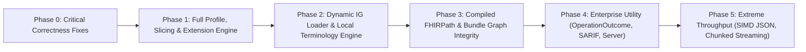

# FHIRlance Roadmap: Superseding the HL7 IG Validator

> [!IMPORTANT]
> **Baseline Advantage**: FHIRlance already validates all 146 FHIR R4 resource types and 39 complex datatypes at **~27,200 resources/sec** in-process (`pydantic-core` Rust hot-path) vs. **~13.0s per JVM invocation** for `validator_cli.jar` (**>1,000x–2,500x faster**). To truly supersede `validator_cli.jar` in production, we must close the semantic validation gaps (slicing, terminology, extensions, FHIRPath, Bundle graph resolution) while preserving our Rust-backed speed advantage.

---

## Forensic Audit: Where We Stand Today

| Capability Dimension | Current State in FHIRlance | Gap vs. `validator_cli.jar` |
| :--- | :--- | :--- |
| **Base R4 Structural** | 146 resources + 39 datatypes in [resources.py](file:///c:/Code/FHIRlance/src/fhirlance/resources.py) & [types.py](file:///c:/Code/FHIRlance/src/fhirlance/types.py) | Complete (`extra="forbid"`, strict primitives, `[x]` exclusivity, `_primitive` extensions). |
| **Profile Engine** | 183 static profiles in [profiles.py](file:///c:/Code/FHIRlance/src/fhirlance/profiles.py) & [profile_engine.py](file:///c:/Code/FHIRlance/src/fhirlance/profile_engine.py) | Unknown profile URLs are silently ignored; `maxLength`, `minValue`/`maxValue`, `mustSupport`, and `type.profile` are dropped. |
| **Slicing** | `fixed` and `pattern` discriminators only ([profile_engine.py](file:///c:/Code/FHIRlance/src/fhirlance/profile_engine.py#L314-L339)) | Colon-qualified sub-paths (`coding:SBPCode`) break `resolve_nodes`; slice `max` cardinality is dropped; `type`/`profile`/`exists` discriminators & `closed`/`ordered` slicing unsupported. |
| **Terminology** | Static R4 `code` string sets ([profile_engine.py](file:///c:/Code/FHIRlance/src/fhirlance/profile_engine.py#L302-L313)) | `isinstance(val, str)` silently skips `CodeableConcept` & `Coding` dicts; IG-specific ValueSets in CA-Baseline/IPS/US-Core aren't loaded; no `extensible` bindings or CodeSystem lookup. |
| **Extensions** | Generic `ext-1` only ([base.py](file:///c:/Code/FHIRlance/src/fhirlance/base.py#L60-L83)) | Zero Extension `StructureDefinition`s compiled; extension `value[x]` type constraints, complex sub-extension slices, context checks, and `modifierExtension` rules are unvalidated. |
| **FHIRPath Invariants** | 8 hardcoded checks in [invariants.py](file:///c:/Code/FHIRlance/src/fhirlance/invariants.py#L45-L170) | No FHIRPath parser/compiler; misses `dom-1..6`, `ref-1`, `que-*`, and all IG differential `ElementDefinition.constraint` expressions. |
| **Bundles & References** | Entry recursion in [resource_validator.py](file:///c:/Code/FHIRlance/src/fhirlance/resource_validator.py#L118-L125) | [dataset.py](file:///c:/Code/FHIRlance/src/fhirlance/dataset.py#L52-L59) unwraps Bundles without validating the outer Bundle or `bdl-*` invariants; `#contained` and `urn:uuid:` refs bypass target checks; no `fullUrl` graph resolution or `targetProfile` conformance. |
| **Output & Ecosystem** | Text summary & custom JSON dict ([cli.py](file:///c:/Code/FHIRlance/src/fhirlance/cli.py)) | No standard FHIR `OperationOutcome`, no SARIF/JUnit for CI, no `-ig` runtime package loader, and file-level-only parallelism. |

---

## Phase 0: Immediate Correctness & Reliability Fixes (P0 Bugs)

> [!CAUTION]
> Auditing [profile_engine.py](file:///c:/Code/FHIRlance/src/fhirlance/profile_engine.py), [dataset.py](file:///c:/Code/FHIRlance/src/fhirlance/dataset.py), and [generate_models.py](file:///c:/Code/FHIRlance/scripts/generate_models.py) surfaced **6 high-impact correctness bugs** where invalid resources silently pass or valid profiled resources falsely fail.

1. **Fix `CodeableConcept` & `Coding` Terminology Binding Bypass** ([profile_engine.py](file:///c:/Code/FHIRlance/src/fhirlance/profile_engine.py#L302-L313))
   - Currently `_check_bindings` checks `if isinstance(val, str)`, silently skipping every `CodeableConcept` (e.g., `Condition.clinicalStatus`, `Observation.code`) and `Coding` element.
   - **Fix**: Inspect `str`, `Coding.code` (+ `system`), and `CodeableConcept.coding[].code` (requiring at least one valid coding in the bound ValueSet).
2. **Load Multi-IG ValueSets & CodeSystems in Codegen** ([generate_models.py](file:///c:/Code/FHIRlance/scripts/generate_models.py#L99-L116))
   - Currently `_load_terminology(R4_PKG)` only reads ValueSets from base R4, ignoring ValueSets defined inside CA-Baseline, Infoway CA Core, IPS, and US Core.
   - **Fix**: Load and expand `CodeSystem` and `ValueSet` resources across all `IG_PKGS` (including `compose.include.concept`, `compose.include.system`, and `compose.include.valueSet` imports).
3. **Fix Sub-Slice Path Resolution Bug (e.g., Blood Pressure `coding:SBPCode`)** ([profile_engine.py](file:///c:/Code/FHIRlance/src/fhirlance/profile_engine.py#L185))
   - Strip `:SliceName` qualifiers from segment keys in `CompiledSlice.matchers` so `code.coding:SBPCode.system` resolves `code -> coding -> system` on the same coding element rather than looking up a literal `"coding:SBPCode"` JSON key.
4. **Enforce Outer `Bundle` Validation in Dataset Runner** ([dataset.py](file:///c:/Code/FHIRlance/src/fhirlance/dataset.py#L52-L59))
   - `_iter_json_resources` unwraps `Bundle.entry[].resource` and discards the outer `Bundle`, skipping `bdl-1`, `bdl-3`, `bdl-4`, `bdl-7` and Bundle profile checks.
   - **Fix**: Validate the outer `Bundle` resource first (while avoiding double-validating `entry[].resource` or deduplicating cleanly).
5. **Fix Empty-List `min >= 1` Bypass & Slice `max` Cardinality Drop** ([profile_engine.py](file:///c:/Code/FHIRlance/src/fhirlance/profile_engine.py#L125-L134))
   - Reject empty lists `[]` in `_check_child_present`, and preserve/enforce `max_count: int | None` in `CompiledSlice` (including slices with `min == 0, max == "0"` or `max == "1"`).
6. **Flag Unknown Declared / Requested Profiles** ([profile_engine.py](file:///c:/Code/FHIRlance/src/fhirlance/profile_engine.py#L348-L350))
   - Instead of silently returning `[]` when a `meta.profile` or `--profile` URL is unknown, emit a configurable warning/error issue (`unknown-profile`).

---

## Phase 1: Complete Slicing, Extension & Element Constraint Engine

To achieve 100% structural/profile parity with `validator_cli.jar` on US Core, IPS, and CA-Baseline:

1. **Full Slicing Semantics** ([profile_engine.py](file:///c:/Code/FHIRlance/src/fhirlance/profile_engine.py))
   - Support all 5 FHIR discriminator types: `value` (`fixed[x]`), `pattern` (`pattern[x]`), `type` (`$this` / polymorphic type check), `profile` (`validate_single_profile` match), and `exists` (presence/absence of path).
   - Enforce slicing rules: `closed` (reject elements matching no defined slice), `openAtEnd` (unmatched elements must appear after matched slices), and `ordered: true` (slices must appear in declared order).
2. **First-Class Extension `StructureDefinition` Validation** ([generate_models.py](file:///c:/Code/FHIRlance/scripts/generate_models.py), [profile_engine.py](file:///c:/Code/FHIRlance/src/fhirlance/profile_engine.py))
   - Extract all `StructureDefinition`s where `type == "Extension"` across R4 Core, US Core, IPS, CA-Baseline, and PS-CA.
   - Validate extension `context` (allowed host paths/resources), `value[x]` allowed types and bindings, and complex extension sub-slices (`extension:ombCategory`, `extension:text`, etc.).
   - Enforce `modifierExtension` rules: verify `isModifier == True` on the definition and flag unknown modifier extensions.
3. **Remaining `ElementDefinition` Constraints**
   - Extract and enforce `maxLength`, `minValue[x]` / `maxValue[x]`, `type.profile` (profiled datatypes like `SimpleQuantity` or `Money`), and optional `--enforce-must-support` validation.
4. **Canadian JHN Checksum & Identifier Formatting** ([canadian.py](file:///c:/Code/FHIRlance/src/fhirlance/canadian.py))
   - Add province-specific JHN format and Luhn/Mod-10 checksum verification (Ontario OHIP 10-digit, BC PHN 10-digit Mod-11, Alberta 9-digit, Quebec RAMQ 4-alpha + 8-digit, Nova Scotia 10-digit, etc.).

---

## Phase 2: Dynamic IG Package Manager & Local Terminology Engine

Right now, adding an IG requires editing [generate_models.py](file:///c:/Code/FHIRlance/scripts/generate_models.py) and regenerating static Python files. To beat `validator_cli.jar` in utility:

1. **Dynamic `-ig` Loader & Package Cache Resolver**
   - Support `--ig <package#version | path/to/package.tgz | path/to/dir>` on the CLI and Python API.
   - Automatically resolve and compile `StructureDefinition`, `ValueSet`, and `CodeSystem` JSONs from `~/.fhir/packages/`, local `.tgz` archives, or directories in milliseconds, caching compiled artifacts in `~/.cache/fhirlance/` keyed by package content hash.
   - Optional `fhirlance pkg install <id>#<version>` to fetch directly from `packages.fhir.org` without needing Java or Node.
2. **Embedded Zero-Latency Terminology Engine**
   - Compile all IG-bundled `CodeSystem`s and `ValueSet`s into an indexed in-memory / memory-mapped lookup table (`(system, code)` membership + intensional `is-a` hierarchy and regex filter evaluation).
   - Validate `required` (error), `extensible` (warning/error if code system overlaps or no valid code), and `preferred` (informational) bindings across `code`, `Coding`, and `CodeableConcept`.
   - Enforce UCUM syntax validation locally (`fhir_ucum`) and standard BCP-47 (`language`), MIME (`contentType`), and ISO-3166 country codes without network calls.
   - Optional pluggable async terminology client (`--tx <url>`) with persistent local SQLite cache for external SNOMED/LOINC/RxNorm lookups when online validation is desired.

---

## Phase 3: Compiled FHIRPath Engine & Bundle Graph Integrity

1. **FHIRPath-to-Python Bytecode Compiler**
   - Instead of interpreting FHIRPath strings slowly at runtime (like the Java validator) or maintaining only 8 hand-coded checks in [invariants.py](file:///c:/Code/FHIRlance/src/fhirlance/invariants.py), build a lightweight **FHIRPath AST compiler** that compiles standard R4 + IG `ElementDefinition.constraint.expression` strings directly into fast Python callables at codegen/IG-load time.
   - Cover 100% of R4 base invariants (`dom-1..6`, `ele-1`, `ext-1`, `ref-1`, `bdl-1..12`, `obs-*`, `que-*`, `med-*`, `us-core-*`, `ips-*`).
2. **Bundle Graph & Reference Resolution Engine**
   - Build a per-Bundle symbol table indexing `entry[].fullUrl` (`urn:uuid:...`, `urn:oid:...`, `ResourceType/id`, absolute URLs) and `contained[].id` (`#id`).
   - Resolve intra-Bundle and contained references to their actual target JSON objects.
   - Verify target `resourceType` and **`targetProfile` conformance** (e.g., verifying that `Observation.subject` inside a Bundle actually conforms to `ca-baseline-patient` or `us-core-patient`).
   - Enforce `type.aggregation` rules (`contained`, `referenced`, `bundled`) and contained resource invariants (`dom-2`: orphan contained resources, `dom-3`, `dom-4`).

---

## Phase 4: Enterprise Utility & Developer Experience

`validator_cli.jar` is notorious for slow JVM startups, cryptic console output, and painful CI integration. FHIRlance can dominate developer workflows with:

1. **Standard FHIR `OperationOutcome` & CI Formats**
   - `--format operation-outcome`: Emit spec-compliant FHIR R4 `OperationOutcome` JSON (with exact `issue[].severity` (`error`/`warning`/`information`), `issue[].code`, `issue[].diagnostics`, `issue[].expression` FHIRPath, and line/column locations).
   - `--format sarif`: Native SARIF 2.1.0 output for one-line GitHub Actions Code Scanning / Azure DevOps integration.
   - `--format html` / `--format junit`: Rich self-contained HTML compliance dashboards and JUnit XML for CI pipelines.
2. **Persistent Validation Server / Daemon & Watch Mode**
   - `fhirlance serve --port 8080`: Sub-millisecond HTTP `$validate` FHIR endpoint (`POST /$validate` and `POST /[ResourceType]/$validate`) so EHR gateways and ETL pipelines can validate payloads in <0.5ms.
   - `fhirlance --watch <dir>`: Instant file-watcher mode for IG authors and data engineers.
3. **Structured Issue Taxonomy & Severity Levels**
   - Replace flat issue strings (`list[str]`) with rich `ValidationIssue` objects (while keeping `list[str]` backward-compatible or providing `validate_resource_detailed()`), distinguishing `error`, `warning`, and `information` with exact JSON pointer / FHIRPath locations.

---

## Phase 5: Next-Level Performance Engineering

Even after adding full FHIRPath, terminology, and Bundle graph resolution, we can push throughput from ~27k resources/sec to **100k+ resources/sec**:

1. **Intra-File Chunked NDJSON & Large-Bundle Parallelism** ([dataset.py](file:///c:/Code/FHIRlance/src/fhirlance/dataset.py))
   - Currently, parallelism splits by file (`pool.map(_validate_file, ...)`), meaning a single 5 GB `.ndjson` file or a 50,000-entry `Bundle` runs on 1 core and buffers all issues in RAM.
   - **Upgrade**: Memory-mapped (`mmap`) byte-offset chunking for large `.ndjson` files across worker processes, plus streaming JSONlines issue output (`--stream`) with O(1) memory overhead.
2. **Fast JSON Parser Integration**
   - Use Pydantic v2's `model_validate_json` (Rust `jiter` parser) directly on raw file bytes / NDJSON lines instead of `json.loads()` -> Python `dict` -> `model_validate()`, eliminating intermediate Python dict allocation on the hot path.
3. **Zero-Exclusion Live `validator_cli.jar` Equivalence Gate**
   - Remove the terminology and reference error filters in [test_all_146_live_hl7_equivalence.py](file:///c:/Code/FHIRlance/tests/test_all_146_live_hl7_equivalence.py#L218-L232) and expand the equivalence suite to test positive and negative fixtures across **all 5 IGs** (R4 Core, CA-Baseline, Infoway CA Core, IPS, US Core) against `validator_cli.jar`.
