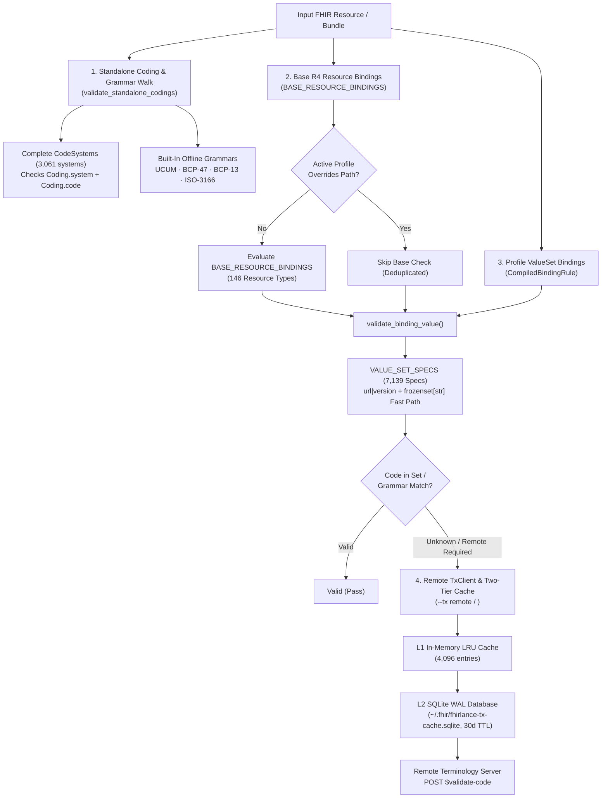

# FHIRlance Terminology Validation Engine & TX Reference

This document provides a comprehensive technical reference for the **FHIRlance Terminology Validation Engine** (`src/fhirlance/terminology.py`, `src/fhirlance/vs_expansion.py`, `src/fhirlance/conceptmap.py`, and compiled terminology tables in `src/fhirlance/profiles.py`).

FHIRlance delivers an ultra-fast, zero-network-by-default terminology engine that validates FHIR R4 codes, units, languages, media types, and country codes in microseconds without sacrificing conformance or requiring a running Java terminology server.

For other topics, see:
- **[CLI & Python API Reference](usage.md)**
- **[Package Architecture & Development Reference](architecture.md)**
- **[Proof of Functional Equivalence & Test Suite Architecture](equivalence-and-testing.md)**
- **[Build & CI/CD Architecture](ci-and-build.md)**
- **[Architecture & Product Roadmap](roadmap.md)**

---

## 1. Architecture Overview & Validation Layers

The FHIRlance terminology validation pipeline operates across **4 layered validation stages**, designed to maximize speed on the hot path while catching invalid codes, grammar violations, and ValueSet binding discrepancies:



### The 4 Validation Layers

1. **Standalone Coding & Quantity Validation (`validate_standalone_codings`)**:
   - Walks all `Coding`, `CodeableConcept`, `Quantity`, and bound `code` elements recursively across the entire resource structure.
   - Embedded sub-resources (`DomainResource.contained[]` and `Bundle.entry[].resource`) are deliberately skipped during the parent walk to prevent duplicate reporting; they are independently validated with explicit path prefixes (e.g. `contained[0].code`, `entry[1].resource:Observation.status`).
   - Validates codes against **`COMPLETE_CODE_SYSTEMS`** (`3,061` systems where `content == "complete"`).
   - Validates systems with formal grammar specifications against native offline grammars.
2. **Built-In Offline Grammar Validators**:
   - Evaluates syntactically defined code systems entirely in memory without external tables:
     - **UCUM** (`http://unitsofmeasure.org`) for clinical and laboratory units of measure.
     - **BCP-47** (`urn:ietf:bcp:47`) for IETF language tags.
     - **BCP-13 MIME** (`urn:ietf:bcp:13` and `http://hl7.org/fhir/ValueSet/mimetypes`) for media types.
     - **ISO-3166-1/2** (`urn:iso:std:iso:3166`, `urn:iso:std:iso:3166:-2`) for countries and regional subdivisions.
3. **Base Resource & Multi-IG Profile ValueSet Bindings (`validate_binding_value`)**:
   - Evaluates **`BASE_RESOURCE_BINDINGS`** across all 146 base FHIR R4 resource types.
   - Evaluates **`PROFILE_CONSTRAINTS["binding_specs"]`** across **198** precompiled profiles and any dynamic `-ig` profiles.
   - Matches codes against **`7,139` precompiled `VALUE_SET_SPECS`** (with `url|version` indexing and unversioned `url` fallback) containing frozen concept sets, system groupings, and external system declarations.
   - **Binding Deduplication**: If an active profile binding governs a resource element (e.g. `Observation.status` in the `vitalsigns` profile), the base resource binding check for that path is automatically skipped to prevent duplicate issues.
4. **Remote `$validate-code` Client & Two-Tier Cache (`TxClient`)**:
   - Used when `--tx remote` or `--tx <url>` is enabled and a code cannot be resolved locally.
   - **Tier 1 (L1)**: Thread-safe in-memory LRU cache (`4,096` items) for zero-latency in-process hits.
   - **Tier 2 (L2)**: Persistent SQLite database at `~/.fhir/fhirlance-tx-cache.sqlite` configured in WAL (Write-Ahead Logging) mode with automatic 30-day TTL expiration and multi-process lock mitigation.
   - **Graceful Network Fallback**: If the remote server is unreachable, times out, or returns a 5xx error, validation does not crash; instead, a non-blocking diagnostic warning is issued.

---

## 2. Terminology Validation Modes (`--tx` / `-tx` / `--term` / `-term`)

FHIRlance supports flexible terminology execution modes via the CLI and Python API:

| Mode | CLI Syntax | TxOptions / API | Behavior & Network Scope |
| :--- | :--- | :--- | :--- |
| **`local`** *(Default)* | `-tx local` or `--tx local` | `TxOptions(mode="local")` | **100% Offline & Zero Network I/O**. Validates built-in grammars, 3,061 complete CodeSystems, and 7,139 precompiled ValueSets. Unresolved codes in external systems (e.g. SNOMED CT, LOINC) pass without error on extensible bindings. |
| **`remote`** | `-tx remote` or `--tx remote` | `TxOptions(mode="remote")` | Validates locally first. If a code belongs to an external system or incomplete ValueSet, queries `https://tx.fhir.org/r4` via `$validate-code` with two-tier L1/L2 SQLite caching. |
| **`<custom-url>`** | `-tx https://my-tx.org/r4` | `TxOptions(mode="remote", server_url="https://my-tx.org/r4")` | Validates locally first, querying the specified custom FHIR R4 terminology server with two-tier L1/L2 SQLite caching. |
| **`off`** | `-tx off`, `-tx none`, `-tx n/a` | `TxOptions(mode="off")` | Disables all standalone coding and ValueSet binding validation. Pure structural, primitive, and invariant validation only. |
| **`--strict-extensible`** | `--strict-extensible` | `TxOptions(..., strict_extensible=True)` | Treats extensible ValueSet binding violations as blocking validation errors (`severity: "error"`) instead of non-blocking diagnostic warnings. |

### Aliases
The CLI accepts `-tx`, `--tx`, `-term`, and `--term` interchangeably.

---

## 3. Built-In Offline Grammar Systems

FHIRlance implements high-speed, zero-dependency tokenizers and grammar evaluators for the 4 primary intensional terminology systems in FHIR R4:

### 3.1 UCUM — Unified Code for Units of Measure (`http://unitsofmeasure.org`)
Evaluates units on `Quantity.unit`, `Quantity.code`, `Observation.valueQuantity`, and UCUM ValueSet bindings (`http://hl7.org/fhir/ValueSet/ucum-units`, `http://hl7.org/fhir/ValueSet/ucum-vitalsigns`).

- **Supported Syntax**:
  - Metric prefixes: `k` (kilo), `m` (milli), `u` (micro), `n` (nano), `d` (deci), `c` (centi), `M` (mega), `G` (giga), etc.
  - SI & clinical base atoms: `g` (gram), `m` (meter), `s` (second), `L` / `l` (liter), `mol` (mole), `Bq` (becquerel), `Cel` (Celsius), `eq` (equivalents), `osm` (osmole), etc.
  - Bracketed customary and clinical atoms: `[in_i]` (inch), `[ft_i]` (foot), `[lb_av]` (pound), `[oz_av]` (ounce), `[degF]` (Fahrenheit), `[IU]` (international unit), `[pH]` (pH), `mm[Hg]` (millimeters of mercury).
  - Exponents & multiplication/division: `mg/dL`, `mmol/L`, `10*3/uL`, `kg/m2`, `mL/min/1.73m2`, `cm[H2O]`.
  - Free-text curly-brace annotations: `{tbl}`, `{cells}`, `{copies}`, `{capsule}`, `mg/{dose}`.
  - Compound division with leading operators: `/min`, `/d`, `/[HPF]`.

```python
# Valid Examples
"mg/dL"  # Milligram per deciliter

"mmol/L"  # Millimole per liter
"mm[Hg]"  # Millimeters of mercury
"10*3/uL"  # Thousand per microliter
"mL/min/1.73m2"  # Glomerular filtration rate
"kg/m2"  # Body mass index
"{tbl}"  # Annotated tablets
"/min"  # Leading division

# Invalid Examples
"invalid / ucum"  # Spaces around operators disallowed
"mg / dL"  # Unescaped whitespace disallowed
"feet"  # Must use UCUM atom [ft_i]
"lbs"  # Must use UCUM atom [lb_av]
```

### 3.2 BCP-47 — Language Tags (`urn:ietf:bcp:47`)
Evaluates languages on `Resource.language`, `Patient.communication.language`, and `AllLanguages` bindings.

- **Complies with RFC 5646**:
  - Primary language subtag (2–3 alpha): `en`, `fr`, `es`, `de`, `zh`, `ar`.
  - Extended language subtags: `zh-cmn`.
  - Script subtags (4 alpha titlecase): `zh-Hans`, `zh-Hant`, `sr-Latn`, `sr-Cyrl`.
  - Region subtags (2 alpha or 3 digit): `en-US`, `en-CA`, `fr-CA`, `es-419`.
  - Variant subtags (5–8 alphanumeric or 4 alphanumeric starting with digit): `sl-nedis`, `ca-valencia`.
  - Singleton extensions: `en-US-u-ca-buddhist`.
  - Private-use subtags: `x-custom`, `en-US-x-private`.
  - Standard grandfathered tags: `i-klingon`, `zh-min-nan`.

```python
# Valid Examples
"en"  # English

"en-CA"  # Canadian English
"fr-CA"  # Canadian French
"zh-Hans-CN"  # Simplified Chinese (China)
"es-419"  # Latin American Spanish

# Invalid Examples
"EN_US"  # Underscores disallowed in BCP-47
"english"  # Full language names disallowed (must use ISO-639 subtags)
"e"  # Single-letter primary language tag invalid
```

### 3.3 BCP-13 — MIME Types (`urn:ietf:bcp:13` & `http://hl7.org/fhir/ValueSet/mimetypes`)
Evaluates content and attachment formats on `Attachment.contentType`, `Binary.contentType`, and `CapabilityStatement.format`.

- **Complies with RFC 2045 & RFC 6838**:
  - Standard top-level media categories: `application`, `text`, `image`, `audio`, `video`, `model`, `multipart`, `message`, `font`.
  - Structured subtype and suffixes: `application/fhir+json`, `application/pdf`, `image/png`, `text/plain`, `application/xml`.
  - Optional media parameters: `text/plain; charset=utf-8`.

```python
# Valid Examples
"application/fhir+json"

"application/pdf"
"image/jpeg"
"text/plain; charset=utf-8"

# Invalid Examples
"pdf"  # Missing top-level media category
"application/"  # Missing subtype
"invalid/type/sub"  # Multiple unescaped slashes
```

### 3.4 ISO-3166 — Country & Subdivision Codes (`urn:iso:std:iso:3166`, `urn:iso:std:iso:3166:-2`)
Evaluates geographic codes on `Address.country`, jurisdiction elements, and country ValueSets.

- **ISO-3166-1**:
  - Alpha-2 (2 uppercase letters): `CA`, `US`, `GB`, `FR`, `DE`, `JP`.
  - Alpha-3 (3 uppercase letters): `CAN`, `USA`, `GBR`, `FRA`, `DEU`, `JPN`.
  - Numeric-3 (3 digits): `124` (Canada), `840` (United States), `250` (France).
- **ISO-3166-2**:
  - Regional subdivisions (`CC-SUB`): `CA-ON` (Ontario), `CA-BC` (British Columbia), `US-CA` (California), `US-NY` (New York), `GB-ENG` (England).

```python
# Valid Examples
"CA"  # Canada (alpha-2)

"CAN"  # Canada (alpha-3)
"124"  # Canada (numeric-3)
"CA-ON"  # Ontario, Canada (subdivision)
"US-CA"  # California, USA (subdivision)

# Invalid Examples
"Canada"  # Full country names not permitted in ISO-3166 code fields
"ZZ"  # Unassigned country code
"CA-XYZ"  # Invalid Canadian provincial subdivision
```

---

## 4. Precompiled Multi-IG CodeSystems & ValueSets

FHIRlance compiles complete terminology models ahead-of-time during build via `scripts/generate_models.py`, storing frozen lookups in `src/fhirlance/profiles.py`.

### 4.1 Complete CodeSystems (`COMPLETE_CODE_SYSTEMS`) & Supplements
- **`3,061` CodeSystems** are precompiled across the 5 standard FHIR packages (`hl7.fhir.r4.core#4.0.1`, `hl7.fhir.ca.baseline#1.2.0`, `ca.infoway.io.core#1.1.0-dft-preballot`, `hl7.fhir.uv.ips#1.0.0`, `hl7.fhir.us.core.r4#8.0.1`) plus **`hl7.terminology.r4#6.2.0`** (UTG).
- Only CodeSystems with **`content == "complete"`** are treated as closed local systems.
- CodeSystems with `content == "not-present"` or `content == "fragment"` (such as SNOMED CT `http://snomed.info/sct` or LOINC `http://loinc.org`) are categorized as external systems and are never falsely flagged as invalid in local mode.
- **`CodeSystem.supplements`**: Supplement CodeSystems (`content == "supplement"`) are merged onto their target base CodeSystems (`supplements` URL, with `url|version` and unversioned fallback) in `vs_expansion.py` so supplemental properties and designations participate in ValueSet filter evaluation.

### 4.2 ValueSet Composition & Expansion (`VALUE_SET_SPECS` & `vs_expansion.py`)
- **`7,139` ValueSet specifications** are compiled into frozen lookup dictionaries (indexed by both `url|version` and unversioned `url`, with automatic unversioned fallback when a pinned version is not found) containing:
  - `codes`: `frozenset[str]` of explicitly declared concepts.
  - `system_codes`: `dict[str, frozenset[str]]` mapping individual CodeSystem URIs to their allowed concepts within that ValueSet.
  - `external_systems`: `tuple[str, ...]` list of external system URIs (e.g. SNOMED CT, LOINC) included in the expansion.
- **Supported `compose` & `expansion` Features (`src/fhirlance/vs_expansion.py`)**:
  - Direct concept inclusions (`compose.include[].concept[].code`) and pre-expanded `expansion.contains` hierarchies.
  - Full system inclusions (`compose.include[].system` without concepts).
  - CodeSystem hierarchy and filter evaluation (`compose.include[].filter`):
    - Hierarchy operators: `is-a`, `descendent-of`, `is-not-a`, `generalizes`, and `child-of`.
    - Property & value operators: `=`, `in`, `not-in`, `regex`, and `exists`.
  - Transitive ValueSet imports (`compose.include[].valueSet`).
  - ValueSet subtraction (`compose.exclude`, including filter and nested `valueSet` exclusions).

### 4.3 Runtime Dynamic IG Terminology (`ig_loader.py`)
When custom IGs are loaded dynamically at runtime via `-ig <path>`, `src/fhirlance/ig_loader.py` extracts custom `CodeSystem` and `ValueSet` definitions on the fly from NPM `.tgz` tarballs, unpacked directories, or FHIR `Bundle` JSON files, adding them to the active validation session without requiring a restart or model re-generation.

---

## 5. Binding Strengths & Evaluation Semantics

FHIR defines 4 binding strengths: `required`, `extensible`, `preferred`, and `example`. FHIRlance validates `required` and `extensible` bindings with exact conformance semantics:

### 5.1 Required vs. Extensible Bindings

| Binding Strength | Local Validation Behavior (`--tx local`) | Remote Mode (`--tx remote`) | Strict Mode (`--strict-extensible`) |
| :--- | :--- | :--- | :--- |
| **`required`** | Code **must** be present in the ValueSet specification or valid according to the grammar. Missing codes or invalid codes produce a blocking **validation error** (`severity: "error"`). | Code must match locally or validate via remote `$validate-code`. Unmatched codes produce a blocking **validation error**. | Same as local/remote. |
| **`extensible`** | 1. If code belongs to a CodeSystem covered by the ValueSet (`system in system_codes`): code must be valid; an invalid code produces a blocking **validation error**.<br/>2. If code belongs to an alternate/external system: produces a non-blocking diagnostic **warning** (`severity: "warning"`). | Same local evaluation, querying remote Tx server for external systems. | Uncovered external codes produce a blocking **validation error** instead of a warning. |
| **`preferred`** | Informational by default; emits a non-blocking `Warning: BestPractice[...]` when `--best-practice` (`best_practice=True`) is enabled and the code is not in the ValueSet. | Same as local, querying remote Tx server when `--best-practice` is enabled. | Informational by default; emits best-practice warning under `--best-practice`. |
| **`example`** | Informational; not evaluated as blocking validation errors. | Informational. | Informational. |

### 5.2 Multi-Coding `CodeableConcept` Semantics

A `CodeableConcept` in FHIR may contain zero or more `Coding` elements and optional fallback `text`. FHIRlance applies the following rules:

1. **At Least One Match**: If at least one `Coding` in `CodeableConcept.coding` matches the bound ValueSet, the entire element is **valid**, even if other codings belong to alternate local or proprietary systems.
2. **Missing Coding on Required Bindings**: If a `CodeableConcept` has no `coding` elements (or only `text`, or codings without a `code` string like `{"display": "..."}`), and the element has a `required` binding, validation fails with an explicit error:
   ```text
   Observation.code has no coding for required ValueSet 'http://hl7.org/fhir/ValueSet/observation-codes'
   ```
3. **Accurate Error Attribution on Extensible Bindings**: If all codings fail to match:
   - If any coding belongs to a known system covered by the ValueSet, the error is attributed to **that** coding, ensuring proprietary codings cannot mask invalid codes from standard systems.
   - If a remote terminology server times out or is unreachable for one coding, the diagnostic warning precisely identifies the specific coding that failed remote resolution.

### 5.3 Parent `required` Strength Preservation

In FHIR profiling, a child profile cannot weaken a parent profile's binding strength (e.g. weakening `required` to `extensible`). During ahead-of-time compilation (`scripts/generate_models.py`) and dynamic loading (`ig_loader.py`), FHIRlance automatically preserves the parent's `required` binding strength when resolving `baseDefinition` inheritance chains (such as US Core Vital Signs inheriting from the base R4 Vital Signs profile).

---

## 6. CLI & Python API Usage

### 6.1 CLI Examples

```bash
# 1. Standard offline validation (default local mode)
fhirlance path/to/observations.ndjson

# 2. Enable remote terminology server with two-tier SQLite caching
fhirlance path/to/patient.json --tx remote

# 3. Use a custom enterprise terminology server (e.g. Ontoserver or Smile CDR)
fhirlance path/to/data --tx https://tx.example.org/r4

# 4. Enforce strict extensible bindings (treat extensible warnings as blocking errors)
fhirlance path/to/data --strict-extensible

# 5. Disable terminology checks entirely (pure structural/invariant validation)
fhirlance path/to/data --tx off

# 6. Emit compliant FHIR R4 OperationOutcome with terminology issue diagnostics
fhirlance path/to/resource.json --operation-outcome -o outcome.json

# 7. Generate SARIF report for GitHub Code Scanning
fhirlance path/to/data --format sarif -o results.sarif.json
```

### 6.2 Python API Examples

#### Basic Resource Validation with Terminology Options

```python
from fhirlance import TxOptions, validate_resource, validate_to_operation_outcome

# Configure terminology options
tx_opts = TxOptions(
    mode="local",  # "local", "remote", or "off"
    strict_extensible=False,  # True to fail on extensible warnings
)

# Validate a resource dictionary
resource = {
    "resourceType": "Observation",
    "status": "final",
    "code": {
        "coding": [
            {
                "system": "http://loinc.org",
                "code": "8867-4",
                "display": "Heart rate",
            }
        ]
    },
    "valueQuantity": {
        "value": 72,
        "system": "http://unitsofmeasure.org",
        "code": "/min",  # Validated by offline UCUM grammar
    },
}

issues = validate_resource(
    resource,
    tx=tx_opts,
)
assert issues == []
```

#### Dataset Validation & Warning Handling

```python
from fhirlance import validate_dataset

# Dataset validation separates blocking issues from non-blocking warnings
report = validate_dataset(
    "path/to/resources",
    parallel=True,
    tx="local",
    strict_extensible=False,
)

print(f"Total Resources: {report['total_resources']}")
print(f"Valid Resources: {report['valid_resources']}")
print(f"Invalid Resources: {report['invalid_resources']}")

# Blocking validation errors (structural, invariant, required binding failures)
for file_path, issues in report["issues"].items():
    print(f"Errors in {file_path}: {issues}")

# Non-blocking diagnostic warnings (extensible bindings, unreachable remote servers)
for file_path, warnings in report["warnings"].items():
    print(f"Warnings in {file_path}: {warnings}")
```

#### Low-Level Terminology API

```python
from fhirlance import (
    TxClient,
    TxOptions,
    parse_tx_options,
    validate_binding_value,
    validate_remote_code,
    validate_standalone_codings,
)

# Parse CLI or dictionary options into a frozen TxOptions instance
options = parse_tx_options("local")

# 1. Validate standalone codings across a resource
result = validate_standalone_codings(resource, options)
print(f"Errors: {result.errors}, Warnings: {result.warnings}")

# 2. Validate a specific binding value (str, Coding, or CodeableConcept)
errors, warnings = validate_binding_value(
    value={"system": "http://unitsofmeasure.org", "code": "mg/dL"},
    path="Observation.valueQuantity",
    vs_url="http://hl7.org/fhir/ValueSet/ucum-units",
    strength="required",
    options=options,
)

# 3. Two-tier caching remote client
client = TxClient(server_url="https://tx.fhir.org/r4")
remote_res = client.validate_code(
    system="http://loinc.org",
    code="8867-4",
    value_set="http://hl7.org/fhir/ValueSet/observation-codes",
)
print(f"Valid: {remote_res.valid}, Display: {remote_res.display}")
```

---

## 7. Report Formatting & Diagnostic Representation

Terminology validation results seamlessly integrate into all FHIRlance output formatters:

### 7.1 FHIR R4 `OperationOutcome`
- **Issue Code**: Terminology issues are mapped to `IssueType.CODE_INVALID` (`code: "code-invalid"`).
- **Severity**:
  - Required binding failures and covered extensible failures emit `severity: "error"`.
  - Uncovered extensible binding warnings emit `severity: "warning"`.
- **Diagnostics & Location**:
  ```json
  {
    "severity": "error",
    "code": "code-invalid",
    "diagnostics": "Terminology[Observation.status]: code 'invalid-status' is not defined in CodeSystem 'http://hl7.org/fhir/observation-status'",
    "expression": ["Observation.status"]
  }
  ```

### 7.2 SARIF v2.1.0 (Static Analysis Results Interchange Format)
- **Rule ID**: Emitted under rule `FHIRLANCE_TERMINOLOGY` (`category: "Terminology"`).
- **Level**: Mapped to `"error"` or `"warning"`.
- Compatible with GitHub Code Scanning alerts and IDE SARIF viewers.

### 7.3 JUnit XML
- Emits `<failure type="code-invalid" message="...">` for terminology errors inside test report suites.

---

## 8. `ConceptMap` & `$translate` (`src/fhirlance/conceptmap.py`)

FHIRlance provides a local-first, remote-fallback `ConceptMap` `$translate` engine:

- **Parsing & Registry**: `parse_concept_map(data)` compiles FHIR R4 `ConceptMap` resources (including `group[].element[].target[]`, `equivalence`, `dependsOn`, and `product`) into frozen `ConceptMapSpec` dataclasses indexed by `ConceptMapRegistry` (by canonical `url`, `url|version`, and `(source, target)` URI pairs).
- **IG Loading**: `load_ig_concept_maps(ig_sources)` extracts all `ConceptMap` resources from `.tgz` packages, unpacked directories, `Bundle`s, or cached IG specifiers into a `ConceptMapRegistry`.
- **Translation (`translate_code`)**: Evaluates `TranslateRequest` (supporting forward and `reverse=True` lookups, `target_system`, `source`/`target` ValueSet scoping, and `depends_on` matching) against the local `ConceptMapRegistry` first, optionally falling back to a remote `TxClient` (`$translate`) when no local `ConceptMap` matches. Returns a `TranslateResult` containing `result: bool`, optional `message`, and `matches: tuple[TranslateMatch, ...]`.
